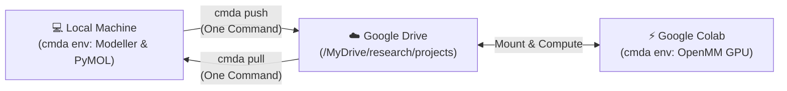
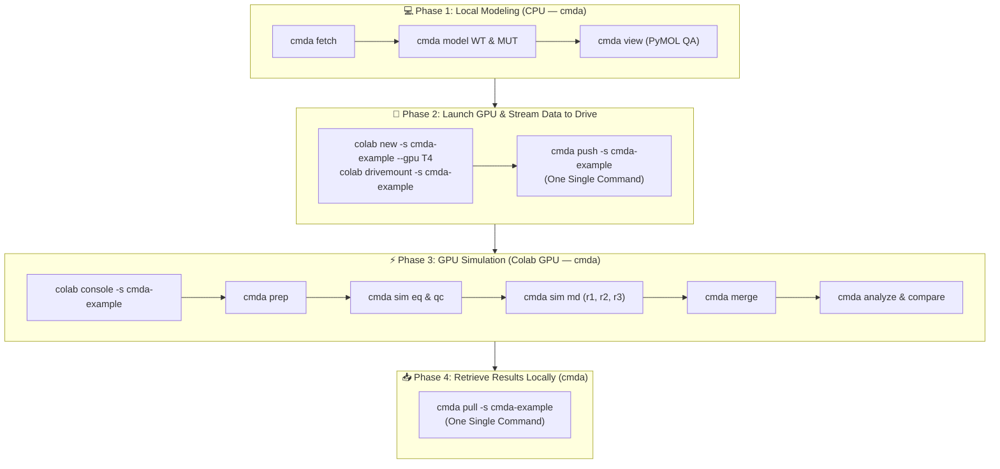

# ColabMDA

[](https://github.com/paulshamrat/ColabMDA/tags) [](https://github.com/paulshamrat/ColabMDA/actions/workflows/python-test.yml) [](https://opensource.org/licenses/MIT) [](https://github.com/paulshamrat/ColabMDA) [](https://github.com/paulshamrat/ColabMDA/issues) [](https://github.com/psf/black) [](https://github.com/astral-sh/ruff)

**ColabMDA** is a specialized framework for running high-quality Molecular Dynamics simulations on Google Colab without the fear of losing your progress. The biggest challenge with Google Colab is session timeouts and disconnections, which frequently destroy hours of simulation work. **ColabMDA fixes this** with a "resume-safe" architecture that continuously saves checkpoints directly to Google Drive. If your session expires, you can resume exactly where you left off with one simple command. From homology modeling and point mutations to 24-stage equilibration and publication-ready comparative figures, ColabMDA handles the entire pipeline using free cloud GPUs.

---

## 1. Installation: Where, What, & When to Install

ColabMDA uses a **Hybrid Architecture** designed to preserve free cloud compute units and avoid session timeouts. To keep workflows simple, the conda environment is named **`cmda`** in both environments:

| Environment | Where It Runs | What Gets Installed | When To Install |
| :--- | :--- | :--- | :--- |
| **1. Local Environment (`cmda`)** | Your Laptop / Workstation (macOS, Linux, WSL) | Python, MODELLER, Open-Source PyMOL, `google-colab-cli`, ColabMDA CLI | **Do this right now (one-time setup).** |
| **2. Cloud GPU Environment (`cmda`)** | Google Colab Cloud VM (NVIDIA T4 / A100) | OpenMM (CUDA), AmberTools `tleap`, MDAnalysis, ColabMDA CLI | **Do this in Phase 3** (only after launching your GPU instance). |



---

### 1.1. Local Installation (Do This Now on Your Workstation)

* **Where:** Your local terminal (macOS, Linux, or Windows WSL).
* **What:** Homology modeling engine (Modeller), interactive 3D viewer (PyMOL), and the Colab remote CLI.
* **When:** Right now, before starting any modeling work.

Run these commands in your local terminal:

```bash
# 1. Create and activate the local conda environment (cmda)
conda create -n cmda python=3.12 -y
conda activate cmda

# 2. Install MODELLER (CPU homology modeling)
conda install -c salilab modeller -y
# In your ~/.bashrc or terminal, configure your free academic license:
# export KEY_MODELLER="YOUR_ACADEMIC_KEY"

# 3. Install Open-Source PyMOL (Interactive 3D visualization)
conda install -c conda-forge pymol-open-source -y

# 4. Install Google Colab CLI & authenticate (one-time browser login)
pip install google-colab-cli
colab sessions

# 5. Install ColabMDA CLI
pip install git+https://github.com/paulshamrat/ColabMDA.git@dev1
```

> [!NOTE]
> **Modeller Academic License:** Modeller is completely free for academic use. Get your license key instantly at [salilab.org/modeller/registration.html](https://salilab.org/modeller/registration.html).

---

### 1.2. Cloud GPU Installation (Do This Later in Phase 3 on Colab)

* **Where:** Inside the Google Colab GPU terminal/console (not on your laptop).
* **What:** Miniforge, OpenMM with CUDA acceleration, AmberTools `tleap`, and MDAnalysis.
* **When:** Later in **Phase 3** when your models are ready and you connect to the cloud GPU.

> [!IMPORTANT]
> **Do NOT launch Google Colab yet!**  
> Fast homology modeling (Modeller) and PyMOL 3D quality checks run locally on your laptop CPU (taking ~20 seconds).  
> You will launch your Google Colab GPU instance in **Phase 2 & 3** when your coordinates are ready for molecular dynamics. This prevents idle Colab timeouts and preserves your free cloud compute quota.

*(When you reach Phase 3, you will provision the cloud environment with these exact commands inside the Colab console):*
```bash
# Inside Colab console (Phase 3):
git clone --branch dev1 https://github.com/paulshamrat/ColabMDA.git /content/ColabMDA
bash /content/ColabMDA/scripts/setup.sh
source /root/miniforge3/etc/profile.d/conda.sh
conda activate cmda
```

---

## 2. Recommended Directory Architecture

ColabMDA maintains a clean, reproducible directory hierarchy organized by biochemical state (**`apo`** and **`atpmg`**):

```text
research/projects/cmda-example/           # Project root in Google Drive / local workspace
└── data/
    ├── apo/                              # Track 1: Apo state (protein in water)
    │   ├── structure/
    │   │   └── O76039_4BGQ/              # Biological Target (UniProt) + Structural Template (PDB)
    │   │       ├── raw/                  # Downloaded archive (4bgq.cif), template.pdb, uniprot.fasta
    │   │       ├── mapping/              # Residue mapping (residues.json) and manifest (input.json)
    │   │       ├── models/
    │   │       │   ├── WT/               # Modeled WT coordinates (WT.pdb)
    │   │       │   └── L119R/            # Modeled L119R coordinates (L119R.pdb)
    │   │       └── STRUCTURE_DONE        # Verification completion marker
    │   │
    │   ├── simulation/
    │   │   └── run01/                    # Run session (defaults automatically to run01)
    │   │       ├── WT/
    │   │       │   ├── 01_prep/          # Solvated Amber system (model.pdb, system.prmtop, system.inpcrd)
    │   │       │   ├── 02_eq/            # 24-stage equilibration hub + qc.png
    │   │       │   └── 03_md/            # Production MD replicas
    │   │       │       ├── r1/           # Replica 1 (chunks + full trajectory)
    │   │       │       ├── r2/           # Replica 2 (independent seed from 02_eq)
    │   │       │       └── r3/           # Replica 3 (triplicate simulation)
    │   │       └── L119R/
    │   │           ├── 01_prep/
    │   │           ├── 02_eq/
    │   │           └── 03_md/{r1, r2, r3}/
    │   │
    │   └── analysis/
    │       └── run01/
    │           ├── WT/{r1, r2, r3}/      # Single-replica reports (RMSD, Rg, RMSF)
    │           ├── L119R/{r1, r2, r3}/
    │           └── compare/figures/      # Triplicate Mean ± SD overlay plots (300 DPI)
    │
    └── atpmg/                            # Track 2: Holo state (ATP + Mg²⁺ complex)
        ├── structure/
        │   └── O76039_4BGQ/
        │       ├── donors/
        │       │   └── 8FP5/             # Isolated cofactor donor crystal archive (8fp5.cif)
        │       ├── raw/                  # Inherited target protein template coordinates
        │       ├── models/
        │       │   ├── WT/
        │       │   │   ├── complex.pdb   # Assembled Protein + ATP + Mg²⁺ complex
        │       │   │   ├── complex.json  # Core RMSD & ATP/Mg coordination audit
        │       │   │   └── ASSEMBLY_DONE
        │       │   └── L119R/
        │       │       └── complex.pdb
        │       └── STRUCTURE_DONE
        │
        ├── simulation/run01/{WT, L119R}/{01_prep, 02_eq, 03_md/{r1, r2, r3}}
        └── analysis/run01/{WT, L119R, compare/figures}
```

### Core Design Principles:

* **Why `UniProt_PDB` Folders (`O76039_4BGQ/`)?**  
  Organizing structures by `<uniprot>_<pdb>` keeps coordinates, mappings, and models cleanly isolated when comparing alternative crystal templates (e.g., 4BGQ vs 8FP5) or modeling multiple targets in the same workspace.
* **Why Dedicated `donors/<template>/` Folders (`donors/8FP5/`)?**  
  In holo simulations, the cofactor donor crystal structure (e.g. 8FP5) is stored in its own dedicated `donors/8FP5/` subfolder. This completely isolates the donor coordinates from the target protein files (`raw/`), making it immediately obvious which PDB provided the backbone vs which provided the ligands.
* **Why `model.pdb` in `01_prep/`?**  
  When running `cmda prep`, ColabMDA retrieves the modeled variant (`WT.pdb` or `complex.pdb`) and copies it into `01_prep/model.pdb`. This creates a self-contained, immutable starting snapshot for that specific simulation run (`run01`), guaranteeing full reproducibility even if upstream modeling files are modified later.
* **Why Shared Equilibration (`02_eq/`)?**  
  The 24-stage equilibration ladder (minimization, thermalization, density relaxation) only needs to be run once per variant. Replicas (`r1`, `r2`, `r3`) fork from `02_eq/` with distinct random velocity seeds, saving dozens of GPU hours while guaranteeing true statistical independence.

---

## 3. Step-by-Step Simulation Workflow (4 Phases)

ColabMDA divides work logically into four sequential phases:



---

### 💻 Phase 1: Local Modeling & Visual QA (Local Machine — `cmda`)
*Execute this on your local laptop or workstation. No GPU is required.*

#### 3.1. Initialize Local Project Workspace
```bash
# 1. Create and navigate to your project directory
# (Replace 'cmda-example' with your custom project name, e.g. cdkl5-dynamics)
mkdir -p ~/research/projects/cmda-example
cd ~/research/projects/cmda-example

# 2. Activate local environment
conda activate cmda
```

#### 3.2. Homology Modeling & Point Mutations (Modeller)
The modeling workflow enforces strict **Biological UniProt Numbering**, automated loop completion, and coordinate validation gates:

```bash
# 1. Fetch template coordinates (PDB 4BGQ) and map UniProt (O76039, residues 1–303)
cmda fetch --state apo --pdb-id 4BGQ --uniprot-id O76039 --range 1 303 --mutations L119R

# 2. Build full Wild-Type model (fills all 27 missing loop residues)
cmda model --state apo --variant WT

# 3. Build Point Mutant (L119R) on the verified WT backbone
cmda model --state apo --variant L119R
```

*What happens behind the scenes:*
* **`cmda fetch` Output Banner**: Displays experimental resolution, coordinate density, missing loop segments, and template sequence checks:
  ```text
  ==============================================================================
   ColabMDA Structural Mapping & Verification
  ==============================================================================
   UniProt Target:   O76039 (Residues 1–303, Total Length: 960 AA)
   Template PDB:     4BGQ (Chain A, Method: X-RAY DIFFRACTION, Resolution: 2.00 Å)
   Coordinate Gate:  276/303 observed residues resolved (91.1% coordinate density)
   Missing Loops:    27 missing residues identified across 4 loop segment(s):
                     - Loop 1: Res 1–8 (8 residues)
                     - Loop 2: Res 46–52 (7 residues)
                     - Loop 3: Res 163–173 (11 residues)
                     - Loop 4: Res 303–303 (1 residues)
   Template Check:   ✓ All 276 observed residues match Canonical UniProt WT
   Mutation Gate:    ✓ Target variant L119R verified on WT residue L119 (coordinate & UniProt match)
   Outputs Saved:    data/apo/structure/O76039_4BGQ/
  ==============================================================================
  ```
* **Engineered Template Mutations**: If crystallographers introduced mutations into the PDB template, `cmda fetch` reports them, and Modeller automatically reverts them to canonical UniProt WT during `cmda model WT`.
* **`cmda model WT`**: Invokes Modeller to build full coordinates for residues 1–303, closing missing loops and preserving author residue numbering.
* **`cmda model L119R`**: Introduces the point mutation onto the verified WT template and optimizes local sidechain rotamers.

#### 3.3. Visual Quality Assurance in Local PyMOL
Verify loop closure and mutated residue rotamers interactively:

```bash
# Inspect Wild-Type model in PyMOL:
cmda view --state apo --variant WT

# Or compare WT and Mutant side-by-side:
pymol data/apo/structure/O76039_4BGQ/models/WT/WT.pdb data/apo/structure/O76039_4BGQ/models/L119R/L119R.pdb
```
*Visual Check:* Confirm loop 163–173 is closed smoothly and Arg119 points into solvent with zero steric clashes.

---

### 🚀 Phase 2: Launch Colab GPU & Stream Data to Drive
*Now that your models are built and visually verified, launch your Colab GPU instance and stream the coordinates to Google Drive.*

In your local terminal:

```bash
# 1. Launch a persistent Colab GPU instance
colab new -s cmda-example --gpu T4

# 2. Mount Google Drive (visit the printed OAuth URL once, then press Enter)
colab drivemount --session cmda-example

# 3. Stream local data/ directly to Google Drive in ONE single command:
cmda push -s cmda-example
```

> 💡 **What `cmda push` Does Automatically:**
> 1. Packages your local `data/` directory (~5 MB).
> 2. Uploads the archive to your active Colab session via `colab upload`.
> 3. Extracts it directly into `/content/drive/MyDrive/research/projects/cmda-example/data/`.
> 4. Automatically deletes the temporary archive.
>
> **No manual tar/zip, no rclone configuration, and zero browser drag-and-drop required!**

*(Passive Alternative: If you use [Google Drive for Desktop](https://www.google.com/drive/download/) and work inside `~/Google Drive/MyDrive/research/projects/cmda-example`, your local files sync automatically in real-time with zero commands).*

---

### ⚡ Phase 3: GPU Simulation & Analysis (Google Colab Cloud — `cmda`)
*Connect to Google Colab to run heavy Amber parameterization and OpenMM molecular dynamics on an NVIDIA GPU.*

#### 3.4. Connect to Colab GPU Console
In your local terminal:
```bash
colab console -s cmda-example
```

Inside the interactive Colab console terminal:

```bash
# ------------------------------------------------------------------------------
# A. One-Time Cloud Setup (only run once per new Colab VM instance):
# ------------------------------------------------------------------------------
git clone --branch dev1 https://github.com/paulshamrat/ColabMDA.git /content/ColabMDA
bash /content/ColabMDA/scripts/setup.sh

# ------------------------------------------------------------------------------
# B. Activate Cloud Environment & Navigate to Drive Project:
# ------------------------------------------------------------------------------
source /root/miniforge3/etc/profile.d/conda.sh
conda activate cmda

cd /content/drive/MyDrive/research/projects/cmda-example
```

#### 3.5. Structure Preparation & 3D pKa Titration (PROPKA at pH 7.4)
Assign physiological protonation states at pH 7.4, solvate with OPC water, neutralize with 150 mM NaCl, and build Amber `ff19SB` topologies:

```bash
# Track 1: Apo state
cmda prep --state apo --variant WT
cmda prep --state apo --variant L119R
```

*Key outputs in `data/<state>/simulation/run01/<variant>/01_prep/`:*
* `model.pdb`: Immutable copy of the input coordinate PDB for complete reproducibility.
* `system.prmtop`: Amber topology containing all physical parameters.
* `system.inpcrd`: Solvated, charge-neutralized initial coordinates.

#### 3.6. Simulation Execution: 24-Stage Equilibration & QC Gate
Run the 24-stage progressive heating and restraint release ladder (EM, NVT heating, NPT density relaxation) on CUDA GPU:

```bash
# 1. Initialize simulation directories
cmda stage --state apo --variant WT

# 2. Run full 24-stage equilibration
cmda sim eq --state apo --variant WT

# 3. Check equilibration stability QC gate (generates qc.png)
cmda sim qc --state apo --variant WT
```

#### 3.7. Production MD Across Triplicates (`03_md/{r1, r2, r3}`)
Replicas fork from `02_eq/` with distinct random velocity seeds into `03_md/`:

```bash
# Replica 1 (100 ns production run, or 10 ns for testing)
cmda sim md --state apo --variant WT --replica r1 --total-ns 100

# Replica 2
cmda sim md --state apo --variant WT --replica r2 --total-ns 100

# Replica 3
cmda sim md --state apo --variant WT --replica r3 --total-ns 100
```
*(Repeat the same commands for mutant: `cmda stage --state apo --variant L119R`, `cmda sim eq ...`, and `cmda sim md ...`).*

> 🛡️ **Resume Safety:** Production MD writes periodic checkpoints (`prod.chk`) directly to Google Drive. If Colab disconnects, simply re-run the exact same `cmda sim md` command to resume with zero lost progress.

#### 💡 How to Resume After a Timeout
If your Google Colab session expires:
1. Re-launch the session and re-mount Drive from your local terminal:
   ```bash
   colab new -s cmda-example --gpu T4
   colab drivemount --session cmda-example
   colab console -s cmda-example
   ```
2. In the console, re-run setup (if on a fresh VM instance):
   ```bash
   [ ! -d "/root/miniforge3/envs/cmda" ] && bash /content/ColabMDA/scripts/setup.sh
   source /root/miniforge3/etc/profile.d/conda.sh
   conda activate cmda
   cd /content/drive/MyDrive/research/projects/cmda-example
   ```
3. Run the exact same `cmda sim md` command—ColabMDA will auto-resume from the last checkpoint.

#### 3.8. Merge Trajectories & Autoimage PBC
Concatenate trajectory chunks, apply periodic boundary condition (PBC) autoimaging, center the protein, and strip solvent:

```bash
# Merge Wild-Type replicas
cmda merge --state apo --variant WT

# Merge Mutant replicas
cmda merge --state apo --variant L119R
```

#### 3.9. Trajectory Analysis & Direct Overlay Comparison
Calculate backbone metrics and overlay WT vs Mutant triplicate statistics:

```bash
# 1. Single-variant analysis (RMSD, Radius of Gyration, RMSF)
cmda analyze --state apo --variant WT
cmda analyze --state apo --variant L119R

# 2. Direct comparative overlay (WT vs L119R with Mean ± SD band)
cmda compare --state apo --variants WT,L119R
```

*Publication-grade figures generated in `data/apo/analysis/run01/compare/figures/`:*
* `rmsd_avg.png`: Backbone RMSD overlay across time (Mean ± SD band, 300 DPI).
* `rg_avg.png`: Radius of gyration ($R_g$) compaction profiles.
* `rmsf_avg.png`: Per-residue flexibility plot highlighting dynamic differences.

---

### 📥 Phase 4: Retrieve Results in ONE Command (Local Workstation — `cmda`)
*When simulations finish, pull the analysis tables, logs, and publication figures back to your laptop in seconds:*

In your local terminal:
```bash
cmda pull -s cmda-example
```

> 💡 **What `cmda pull` Does Automatically:**
> 1. Packages analysis CSVs, logs, summary manifests, and 300 DPI PNG plots from Google Drive.
> 2. Excludes heavy trajectory files (`.dcd`, `.chk`) by default so the download finishes in ~2 seconds.
> 3. Extracts everything directly into your local `data/` folder.
> 4. Cleans up temporary cloud archives.
>
> *(To download full multi-gigabyte raw trajectories as well, pass `--all`: `cmda pull -s cmda-example --all`).*

---

## 4. Track 2: Holo Dynamics (ATP + $\text{Mg}^{2+}$ Coordination)

To study catalytic active-site dynamics and cofactor coordination, assemble ATP and $\text{Mg}^{2+}$ from donor PDB 8FP5 onto your modeled kinase structures.

### 4.1. What Happens to the Template and Donor Structures?
* **Target Coordinates (`raw/`):** PDB 4BGQ provides the sequence and backbone geometry for the target kinase (CDKL5, residues 1–303).
* **Cofactor Donor Coordinates (`donors/8FP5/`):** PDB 8FP5 (CDK2 in complex with ATP and $\text{Mg}^{2+}$) is downloaded into its own isolated `donors/8FP5/` folder.
* **Structural Assembly:** ColabMDA aligns the conserved catalytic core kinase motifs (residues 30–220), transfers ATP and $\text{Mg}^{2+}$, relaxes steric clashes in active site sidechains, and writes `complex.pdb` and `complex.json` into `models/WT/` and `models/L119R/`.

### 4.2. Local Holo Assembly (Local Terminal — `cmda`)
```bash
# 1. Assemble Holo Wild-Type from CDK2 donor (PDB 8FP5)
cmda assemble --state atpmg --variant WT --template 8FP5 --relax-sidechains

# 2. Assemble Holo Mutant (L119R) from the same donor pose
cmda assemble --state atpmg --variant L119R --template 8FP5 --relax-sidechains

# 3. Push to Google Drive
cmda push -s cmda-example
```

### 4.3. Holo Parameterization & Simulation (Colab Console — `cmda`)
ColabMDA automatically incorporates the **Hu et al. B3 parameter set** for ATP and the **Li–Merz 12–6 compromise model** for $\text{Mg}^{2+}$:

```bash
# 1. Solvate and parameterize Holo complexes
cmda prep --state atpmg --variant WT
cmda prep --state atpmg --variant L119R

# 2. Stage directories and run 24-stage equilibration
cmda stage --state atpmg --variant WT
cmda sim eq --state atpmg --variant WT
cmda sim qc --state atpmg --variant WT

# 3. Run production MD triplicates
cmda sim md --state atpmg --variant WT --replica r1 --total-ns 100
cmda sim md --state atpmg --variant WT --replica r2 --total-ns 100
cmda sim md --state atpmg --variant WT --replica r3 --total-ns 100

# 4. Merge trajectories and compare WT vs Mutant
cmda merge --state atpmg --variant WT
cmda merge --state atpmg --variant L119R
cmda analyze --state atpmg --variant WT
cmda analyze --state atpmg --variant L119R
cmda compare --state atpmg --variants WT,L119R
```

---

## 5. Trajectory Visualization in PyMOL

Visualize molecular dynamics trajectories in PyMOL with full secondary structure (ribbon/cartoon) and active site sidechains:

### 5.1. Launch Trajectory View (Local Machine — `cmda`)
```bash
# View Wild-Type trajectory frame
cmda view --state apo --variant WT --replica r1

# Generate 3x8 transition snapshot grids comparing WT vs Mutant
cmda snapshots --state apo
```

---

## 6. Advanced Environments & HPC (SLURM)

<details>
<summary><b>🧪 Running the Test Suite Locally</b></summary>

Verify code integrity, force field mechanics, and CLI parsing:
```bash
pytest tests/ -v
```
</details>

<details>
<summary><b>🏢 HPC Usage (SLURM)</b></summary>

ColabMDA scripts can be integrated directly into SLURM job submission arrays. Because chunked simulations write discrete `.chk` checkpoints, jobs finish cleanly within standard cluster walltime limits.
</details>

---

## Acknowledgements
- [OpenMM](https://openmm.org) & [PDBFixer](https://github.com/openmm/pdbfixer)
- [Modeller](https://salilab.org/modeller/)
- [AmberTools](https://ambermd.org/AmberTools.php)
- [MDAnalysis](https://www.mdanalysis.org) & [MDTraj](https://www.mdtraj.org)
- [PDB2PQR & PROPKA](https://server.poissonboltzmann.org/)
- [NumPy](https://numpy.org), [Matplotlib](https://matplotlib.org), [Biopython](https://biopython.org)
- [Google Colab](https://colab.research.google.com) & [Miniforge/Conda](https://github.com/conda-forge/miniforge)

---

## Changelog

### v0.2.0 (Kinase Architectures, Amber ff19SB & Resilience)
*   **One-Command Sync (`cmda push` & `cmda pull`):** Direct streaming between local workstation and remote Google Drive via Google Colab CLI, eliminating manual archiving and rclone setup.
*   **Cofactor Donor Isolation:** Dedicated `donors/<template>/` directory hierarchy preserving donor crystal integrity.
*   **Target Hierarchy (`<uniprot>_<pdb>`):** Clean segregation for multi-template and multi-protein workspaces.
*   **Unified CLI (`cmda`):** Intuitive top-level commands (`fetch`, `model`, `assemble`, `push`, `prep`, `stage`, `sim`, `merge`, `analysis`, `compare`, `pull`, `view`).
*   **Dual State Architecture:** Clean separation between unliganded **`apo`** dynamics and catalytic **`atpmg`** holo dynamics.
*   **Automated Triplicate Comparison:** Single-call `cmda compare --state <state> --variants WT,MUT` generating publication-grade Mean ± SD overlay plots.
*   **24-Stage Equilibration Hub:** Robust heating and restraint release ladder guaranteeing stable density and temperature.
*   **PROPKA 3D pKa Titration & AmberTools `tleap`:** Physiological pH 7.4 protonation assignment with Amber ff19SB and OPC 4-point water.
*   **Resume-Safe Checkpointing:** Automated recovery from Google Colab session timeouts.

### v0.1.0 (Initial Beta)
*   Modular pipeline for EM, NVT, NPT, and Production MD.
*   Checkpointing logic for fail-safe simulations on Google Colab.
*   Wild-Type building and mutation support via Modeller.

---

## Citation

If you use ColabMDA in your research, please cite the underlying studies:

> Paul SK, Saddam M, Rahaman KA, Choi JG, Lee SS, Hasan M. **Molecular modeling, molecular dynamics simulation, and essential dynamics analysis of grancalcin: An upregulated biomarker in experimental autoimmune encephalomyelitis mice.** *Heliyon*. 2022 Oct 23;8(10):e11232. doi: [10.1016/j.heliyon.2022.e11232](https://doi.org/10.1016/j.heliyon.2022.e11232). PMID: 36340004; PMCID: PMC9626934.
>
> [](https://doi.org/10.1016/j.heliyon.2022.e11232)
>
> Paul SK, Saddam M, Tabassum N, Hasan M. **Molecular dynamics simulation of wild and mutant proteasome subunit beta type 8 (PSMB8) protein: Implications for restoration of inflammation in experimental autoimmune encephalomyelitis pathogenesis.** *Heliyon*. 2024 Dec 15;11(1):e41166. doi: [10.1016/j.heliyon.2024.e41166](https://doi.org/10.1016/j.heliyon.2024.e41166). PMID: 39802026; PMCID: PMC11719297.
>
> [](https://doi.org/10.1016/j.heliyon.2024.e41166)

---

<p align="center">
  
</p>
