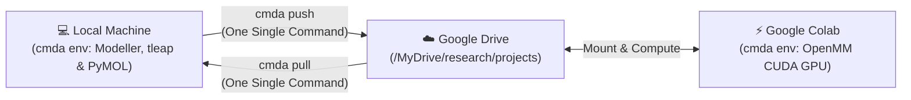
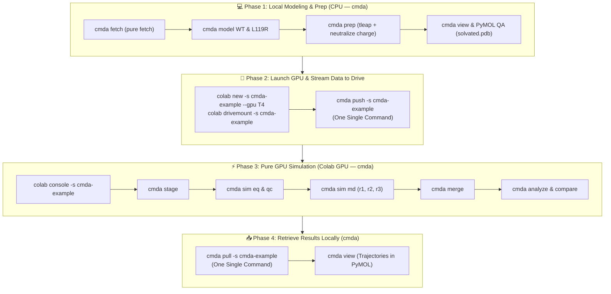

# ColabMDA

[](https://github.com/paulshamrat/ColabMDA/tags) [](https://github.com/paulshamrat/ColabMDA/actions/workflows/python-test.yml) [](https://opensource.org/licenses/MIT) [](https://github.com/paulshamrat/ColabMDA) [](https://github.com/paulshamrat/ColabMDA/issues) [](https://github.com/psf/black) [](https://github.com/astral-sh/ruff)

**ColabMDA** is a specialized framework for running high-quality Molecular Dynamics simulations on Google Colab without the fear of losing your progress. The biggest challenge with Google Colab is session timeouts and disconnections, which frequently destroy hours of simulation work. **ColabMDA fixes this** with a "resume-safe" architecture that continuously saves checkpoints directly to Google Drive. If your session expires, you can resume exactly where you left off with one simple command. From homology modeling and point mutations to 24-stage equilibration and publication-ready comparative figures, ColabMDA handles the entire pipeline using free cloud GPUs.

📖 **Full Documentation:** Visit our official manual at [colabmda.readthedocs.io](https://colabmda.readthedocs.io/)

---

## 1. Installation: Universal One-Command Setup

ColabMDA uses a **Hybrid Architecture** designed to preserve free cloud compute units and avoid session timeouts. To keep workflows simple, the conda environment is named **`cmda`** across both environments:

| Environment | Where It Runs | What Gets Installed | When To Install & Use |
| :--- | :--- | :--- | :--- |
| **1. Local Environment (`cmda`)** | Your Laptop / Workstation (macOS, Linux, WSL) | Python, MODELLER, Open-Source PyMOL, AmberTools (`tleap`), MDAnalysis, `google-colab-cli`, ColabMDA CLI | **Do this right now (one-time setup).** Used for Phase 1 (Modeling, Structure Prep, Solvation, PyMOL QA, Cloud Management) and Phase 4 (Inspection). |
| **2. Cloud GPU Environment (`cmda`)** | Google Colab Cloud VM (NVIDIA T4 / A100 / L4) | Miniforge, OpenMM (CUDA), AmberTools `tleap`, MDAnalysis, ColabMDA CLI | **Do this in Phase 3** (only after launching your GPU instance). Runs 100% unattended in ~90 seconds with zero license prompts. |



---

### 1.1. Local Installation (Do This Now on Your Workstation)

A single bootstrap script sets up Miniforge, the `cmda` conda environment, Modeller, PyMOL, AmberTools, MDAnalysis, and `google-colab-cli` automatically—**without requiring you to clone the git repository**:

```bash
# 1. Download and run the universal bootstrap script (no git clone needed):
curl -fsSL https://raw.githubusercontent.com/paulshamrat/ColabMDA/dev1/scripts/setup.sh -o setup.sh && bash setup.sh

# 2. Activate the environment
source ~/miniforge3/etc/profile.d/conda.sh
conda activate cmda

# 3. Authenticate Google Colab CLI (one-time browser login)
colab sessions
```

> [!NOTE]
> **Modeller Academic License:** Modeller is completely free for academic use. Obtain your license key at [salilab.org/modeller/registration.html](https://salilab.org/modeller/registration.html). During local `setup.sh`, you will be prompted once to enter your license key, or you can provide it ahead of time:
> ```bash
> export KEY_MODELLER="YOUR_ACADEMIC_KEY"
> bash setup.sh
> ```

<details>
<summary><b>🛠️ Developer Alternative: Clone from Source</b></summary>

If you are developing new features or contributing code to ColabMDA, you can clone the repository directly:
```bash
git clone --branch dev1 https://github.com/paulshamrat/ColabMDA.git ~/ColabMDA
cd ~/ColabMDA
bash scripts/setup.sh
```
</details>

---

### 1.2. Cloud GPU Provisioning (On-Demand Compute Engine)

ColabMDA decouples structural modeling from GPU simulation. While Phase 1 (modeling, loop completion, and Amber solvation) runs on your local workstation CPU, heavy molecular dynamics simulations run on cloud GPUs.

Google Colab instances are ephemeral (they spin up on demand). When you launch your GPU instance in Phase 3, the exact same bootstrap script provisions the cloud environment in ~90 seconds:

```bash
# Provision Cloud GPU Worker (executed inside Colab console during Phase 3):
curl -fsSL https://raw.githubusercontent.com/paulshamrat/ColabMDA/dev1/scripts/setup.sh | bash
source /root/miniforge3/etc/profile.d/conda.sh
conda activate cmda
```

> [!NOTE]
> **Zero License Prompts on Cloud:**  
> Because homology modeling is already completed locally on your workstation, MODELLER and PyMOL are automatically excluded on Colab (`WITH_MODELLER=0`). Google Colab only installs Miniforge, OpenMM (CUDA), AmberTools `tleap`, MDAnalysis, and ColabMDA. Setup runs **100% unattended in ~90 seconds with zero interactive prompts**.
>
> *Follow the step-by-step workflow below: you will execute this one-liner when you connect to your GPU console in [Phase 3 (Section 3.6)](#36-connect-to-colab-gpu-console).*

---

## 2. Recommended Directory Architecture

ColabMDA maintains a clean, reproducible directory hierarchy organized by biochemical state (**`apo`** and **`atpmg`**):

```text
research/projects/cmda-example/           # Project root in Google Drive / local workspace
└── data/
    ├── apo/                              # Track 1: Apo state (protein in water)
    │   ├── structure/
    │   │   └── O76039_4BGQ/              # Biological Target (UniProt) + Structural Template (PDB)
    │   │       ├── raw/                  # Downloaded archive (4bgq.cif), template.pdb, uniprot.fasta
    │   │       ├── mapping/              # Residue mapping (residues.json) and manifest (input.json)
    │   │       ├── models/
    │   │       │   ├── WT/               # Modeled WT coordinates (WT.pdb)
    │   │       │   └── L119R/            # Modeled L119R coordinates (L119R.pdb)
    │   │       └── STRUCTURE_DONE        # Verification completion marker
    │   │
    │   ├── simulation/
    │   │   ├── WT/
    │   │   │   ├── 01_prep/              # Solvated Amber system (model.pdb, solvated.pdb, system.prmtop, system.inpcrd)
    │   │   │   ├── 02_eq/                # 24-stage equilibration hub + qc.png
    │   │   │   └── 03_md/                # Production MD replicas
    │   │   │       ├── r1/               # Replica 1 (chunks + full trajectory)
    │   │   │       ├── r2/               # Replica 2 (independent seed from 02_eq)
    │   │   │       └── r3/               # Replica 3 (triplicate simulation)
    │   │   └── L119R/
    │   │       ├── 01_prep/
    │   │       ├── 02_eq/
    │   │       └── 03_md/{r1, r2, r3}/
    │   │
    │   └── analysis/                     # Created only when cmda analyze / compare runs!
    │       ├── WT/{r1, r2, r3}/          # Single-replica reports (RMSD, Rg, RMSF)
    │       ├── L119R/{r1, r2, r3}/
    │       └── compare/figures/          # Triplicate Mean ± SD overlay plots (300 DPI)
    │
    └── atpmg/                            # Track 2: Holo state (ATP + Mg²⁺ complex)
        ├── structure/
        │   └── O76039_4BGQ/
        │       ├── donors/
        │       │   └── 8FP5/             # Isolated cofactor donor crystal archive (8fp5.cif)
        │       ├── raw/                  # Inherited target protein template coordinates
        │       ├── models/
        │       │   ├── WT/
        │       │   │   ├── complex.pdb   # Assembled Protein + ATP + Mg²⁺ complex
        │       │   │   ├── complex.json  # Core RMSD & ATP/Mg coordination audit
        │       │   │   └── ASSEMBLY_DONE
        │       │   └── L119R/
        │       │       └── complex.pdb
        │       └── STRUCTURE_DONE
        │
        ├── simulation/{WT, L119R}/{01_prep, 02_eq, 03_md/{r1, r2, r3}}
        └── analysis/{WT, L119R, compare/figures}
```

### Core Design Principles:

* **Why `UniProt_PDB` Folders (`O76039_4BGQ/`)?**  
  Organizing structures by `<uniprot>_<pdb>` keeps coordinates, mappings, and models cleanly isolated when comparing alternative crystal templates (e.g., 4BGQ vs 8FP5) or modeling multiple targets in the same workspace.
* **Why Dedicated `donors/<template>/` Folders (`donors/8FP5/`)?**  
  In holo simulations, the cofactor donor crystal structure (e.g. 8FP5) is stored in its own dedicated `donors/8FP5/` subfolder. This completely isolates the donor coordinates from the target protein files (`raw/`), making it immediately obvious which PDB provided the backbone vs which provided the ligands.
* **Why `01_prep/` Runs Locally in Phase 1?**  
  Running `cmda prep` locally parameterizes the protein with AmberTools `tleap`, adds OPC 4-point water, neutralizes net charge (matching standard published protocols), and creates `solvated.pdb`. This allows visual inspection of the water box in local PyMOL *before* uploading to Google Drive.
* **Why `model.pdb` in `01_prep/`?**  
  When running `cmda prep`, ColabMDA retrieves the modeled variant (`WT.pdb` or `complex.pdb`) and copies it into `01_prep/model.pdb`. This creates a self-contained, immutable starting snapshot for that specific simulation, guaranteeing full reproducibility even if upstream modeling files are modified later.
* **Why Shared Equilibration (`02_eq/`)?**  
  The 24-stage equilibration ladder (minimization, thermalization, density relaxation) only needs to be run once per variant. Replicas (`r1`, `r2`, `r3`) fork from `02_eq/` with distinct random velocity seeds, saving dozens of GPU hours while guaranteeing true statistical independence.

---

## 3. Step-by-Step Simulation Workflow (4 Phases)

ColabMDA divides work logically into four sequential phases:



---

### 💻 Phase 1: Local Modeling & Structure Preparation (Local Machine — `cmda`)
*Execute this on your local laptop or workstation. No GPU is required.*

#### 3.1. Initialize Local Project Workspace
```bash
# 1. Create and navigate to your project directory
mkdir -p ~/research/projects/cmda-example
cd ~/research/projects/cmda-example

# 2. Activate local environment
conda activate cmda
```

#### 3.2. Structural Fetching & Biological UniProt Mapping
The `cmda fetch` command strictly downloads the crystal structure, resolves biological UniProt numbering, and identifies missing loop coordinates:

```bash
# Fetch template coordinates (PDB 4BGQ) and map UniProt (O76039, residues 1–303)
cmda fetch --state apo --pdb-id 4BGQ --uniprot-id O76039 --range 1 303
```

*Terminal Verification Banner:*
```text
==============================================================================
 ColabMDA Structural Mapping & Verification
==============================================================================
 UniProt Target:   O76039 (Residues 1–303, Total Length: 960 AA)
 Template PDB:     4BGQ (Chain A, Method: X-RAY DIFFRACTION, Resolution: 2.00 Å)
 Coordinate Gate:  276/303 observed residues resolved (91.1% coordinate density)
 Missing Loops:    27 missing residues identified across 4 loop segment(s):
                   - Loop 1: Res 1–8 (8 residues)
                   - Loop 2: Res 46–52 (7 residues)
                   - Loop 3: Res 163–173 (11 residues)
                   - Loop 4: Res 303–303 (1 residues)
 Template Check:   ✓ All 276 observed residues match Canonical UniProt WT
 Outputs Saved:    data/apo/structure/O76039_4BGQ/
==============================================================================
```

#### 3.3. Homology Modeling & Point Mutations (Modeller)
Model the complete Wild-Type coordinates, closing all 27 missing loop residues, then introduce point mutations on the verified WT backbone:

```bash
# 1. Build full Wild-Type model (UniProt canonical, fills all 27 missing loop residues)
cmda model --state apo --variant WT

# 2. Build Point Mutant (L119R) on the verified WT backbone
cmda model --state apo --variant L119R
```

*What happens behind the scenes:*
* **Engineered Template Mutations**: If crystallographers introduced mutations into the PDB template, `cmda fetch` detects them, and Modeller automatically reverts them to canonical UniProt WT during `cmda model WT`.
* **`cmda model WT`**: Invokes Modeller to build full coordinates for residues 1–303, closing missing loops and preserving author residue numbering.
* **`cmda model L119R`**: Introduces the point mutation onto the verified WT template and optimizes local sidechain rotamers.

#### 3.4. Structure Preparation & Solvation (AmberTools `tleap` + PROPKA at pH 7.4)
Prepare the solvated systems locally using CPU-bound AmberTools. By default, ColabMDA neutralizes system charge with counterion(s) only (matching standard published protocols):

```bash
# Solvate with OPC water, neutralize net charge, assign AMBER titratable protonation states
cmda prep --state apo --variant WT
cmda prep --state apo --variant L119R

# Optional: Add 150 mM physiological saline if specifically desired:
# cmda prep --state apo --variant WT --salt 0.15
```

*Key outputs generated in `data/apo/simulation/<variant>/01_prep/`:*
* `model.pdb`: Immutable copy of the input coordinate PDB for complete reproducibility.
* `solvated.pdb`: Solvated coordinate PDB with protein, water box, and neutralized counterion(s).
* `system.prmtop`: Amber topology containing all `ff19SB` physical parameters.
* `system.inpcrd`: Solvated, charge-neutralized initial coordinates.
* `protonation_summary.json`: Audit log of explicit protonation states assigned by PROPKA at pH 7.4.

#### 3.5. Visual Quality Assurance in Local PyMOL
Verify loop closure, mutated residue rotamers, and the solvated water box interactively before uploading:

```bash
# 1. Inspect Wild-Type model coordinates:
cmda view --state apo --variant WT

# 2. Compare WT and Mutant side-by-side in PyMOL:
pymol data/apo/structure/O76039_4BGQ/models/WT/WT.pdb data/apo/structure/O76039_4BGQ/models/L119R/L119R.pdb

# 3. Inspect the fully solvated system (water box + neutralizing counterions):
pymol data/apo/simulation/WT/01_prep/solvated.pdb
```
*Visual Check:* Confirm loop 163–173 is closed smoothly, Arg119 points into solvent with zero steric clashes, and the OPC water box has adequate padding (~14 Å).

---

### 🚀 Phase 2: Launch Colab GPU & Stream Data to Drive
*Now that your models and solvated Amber parameters are built and verified locally, launch your Colab GPU instance and stream the coordinates to Google Drive.*

In your local terminal:

```bash
# 1. Launch a persistent Colab GPU instance
colab new -s cmda-example --gpu T4

# 2. Mount Google Drive (visit the printed OAuth URL once, then press Enter)
colab drivemount --session cmda-example

# 3. Stream local data/ directly to Google Drive in ONE single command:
cmda push -s cmda-example
```

> 💡 **Where does `cmda push` upload your files?**
> * **Google Drive Web UI ([drive.google.com](https://drive.google.com)):**  
>   `My Drive` > `research` > `projects` > `cmda-example` > `data/`
> * **Google Colab Filesystem Path:**  
>   `/content/drive/MyDrive/research/projects/cmda-example/data/`
> * **How It Works Under the Hood:**  
>   1. Packages your local `data/` folder (including modeled structures and prepared Amber parameters, ~12 MB).
>   2. Streams it through your active Colab VM (`-s cmda-example`).
>   3. Extracts it directly into your mounted Google Drive project directory.
>   4. Cleans up temporary transit archives automatically in ~3 seconds.
>
> **No manual tar/zip, no rclone setup, and zero browser drag-and-drop!**

---

### ⚡ Phase 3: Pure GPU Simulation & Analysis (Google Colab Cloud — `cmda`)
*Connect to Google Colab to run heavy OpenMM molecular dynamics simulations on an NVIDIA GPU. Because modeling and structure preparation are already finished locally, Google Colab setup runs 100% unattended with zero license prompts!*

#### 3.6. Connect to Colab GPU Console
In your local terminal:
```bash
colab console -s cmda-example
```

Inside the interactive Colab console terminal, run the cloud bootstrap (from [Section 1.2](#12-cloud-gpu-provisioning-on-demand-compute-engine)):

```bash
# ------------------------------------------------------------------------------
# A. One-Time Cloud Setup (unattended in ~90s, zero license prompts):
# ------------------------------------------------------------------------------
curl -fsSL https://raw.githubusercontent.com/paulshamrat/ColabMDA/dev1/scripts/setup.sh | bash

# ------------------------------------------------------------------------------
# B. Activate Cloud Environment & Navigate to Drive Project:
# ------------------------------------------------------------------------------
source /root/miniforge3/etc/profile.d/conda.sh
conda activate cmda

cd /content/drive/MyDrive/research/projects/cmda-example
```

#### 3.7. Stage Simulation Hubs & 24-Stage Equilibration
Stage the simulation directories and execute the 24-stage progressive heating and restraint release ladder (EM, NVT heating, NPT density relaxation) on CUDA GPU:

```bash
# 1. Initialize simulation directories
cmda stage --state apo --variant WT
cmda stage --state apo --variant L119R

# 2. Run full 24-stage equilibration for WT
cmda sim eq --state apo --variant WT
cmda sim qc --state apo --variant WT

# 3. Run full 24-stage equilibration for L119R
cmda sim eq --state apo --variant L119R
cmda sim qc --state apo --variant L119R
```

#### 3.8. Production MD Across Triplicates (`03_md/{r1, r2, r3}`)
Replicas fork from `02_eq/` with distinct random velocity seeds into `03_md/`:

```bash
# Wild-Type Triplicates (100 ns production runs)
cmda sim md --state apo --variant WT --replica r1 --total-ns 100
cmda sim md --state apo --variant WT --replica r2 --total-ns 100
cmda sim md --state apo --variant WT --replica r3 --total-ns 100

# Mutant Triplicates (100 ns production runs)
cmda sim md --state apo --variant L119R --replica r1 --total-ns 100
cmda sim md --state apo --variant L119R --replica r2 --total-ns 100
cmda sim md --state apo --variant L119R --replica r3 --total-ns 100
```

> 🛡️ **Resume Safety:** Production MD writes periodic checkpoints (`prod.chk`) directly to Google Drive. If Colab disconnects, simply re-run the exact same `cmda sim md` command to resume with zero lost progress.

#### 💡 How to Resume After a Timeout
If your Google Colab session expires:
1. Re-launch the session and re-mount Drive from your local terminal:
   ```bash
   colab new -s cmda-example --gpu T4
   colab drivemount --session cmda-example
   colab console -s cmda-example
   ```
2. In the console, re-activate the environment:
   ```bash
   [ ! -d "/root/miniforge3/envs/cmda" ] && curl -fsSL https://raw.githubusercontent.com/paulshamrat/ColabMDA/dev1/scripts/setup.sh | bash
   source /root/miniforge3/etc/profile.d/conda.sh
   conda activate cmda
   cd /content/drive/MyDrive/research/projects/cmda-example
   ```
3. Run the exact same `cmda sim md` command—ColabMDA will auto-resume from the last checkpoint.

#### 3.9. Merge Trajectories & Autoimage PBC
Concatenate trajectory chunks, apply periodic boundary condition (PBC) autoimaging, center the protein, and strip solvent:

```bash
# Merge Wild-Type replicas
cmda merge --state apo --variant WT

# Merge Mutant replicas
cmda merge --state apo --variant L119R
```

#### 3.10. Trajectory Analysis & Direct Overlay Comparison
Calculate backbone metrics and overlay WT vs Mutant triplicate statistics:

```bash
# 1. Single-variant analysis (RMSD, Radius of Gyration, RMSF)
cmda analyze --state apo --variant WT
cmda analyze --state apo --variant L119R

# 2. Direct comparative overlay (WT vs L119R with Mean ± SD band)
cmda compare --state apo --variants WT,L119R
```

*Publication-grade figures generated in `data/apo/analysis/compare/figures/`:*
* `rmsd_avg.png`: Backbone RMSD overlay across time (Mean ± SD band, 300 DPI).
* `rg_avg.png`: Radius of gyration ($R_g$) compaction profiles.
* `rmsf_avg.png`: Per-residue flexibility plot highlighting dynamic differences.

---

### 📥 Phase 4: Retrieve Results in ONE Command (Local Workstation — `cmda`)
*When simulations finish, pull the analysis tables, logs, and publication figures back to your laptop in seconds:*

In your local terminal:
```bash
cmda pull -s cmda-example
```

> 💡 **What `cmda pull` Does Automatically:**
> 1. Packages analysis CSVs, logs, summary manifests, and 300 DPI PNG plots from Google Drive.
> 2. Excludes heavy raw trajectory files (`.dcd`, `.chk`) by default so the download finishes in ~2 seconds.
> 3. Extracts everything directly into your local `data/` folder.
> 4. Cleans up temporary cloud archives.
>
> *(To download full multi-gigabyte raw trajectories as well, pass `--all`: `cmda pull -s cmda-example --all`).*

#### 3.11. Visualizing Trajectories in Local PyMOL
Inspect trajectory dynamics in local PyMOL:
```bash
# View Wild-Type production trajectory
cmda view --state apo --variant WT --replica r1
```

---

## 4. Trajectory Mathematics, Storage Budgeting & Reference Guidelines

### 4.1. ⏱️ Understanding Simulation Time vs. Frame Counts
Use this formula to calculate expected trajectory frames:
$$\text{Expected Frames} = \frac{\text{Total Time (ps)}}{\text{Trajectory Saving Interval (ps)}}$$

* **Example:** A $100.0\text{ ns}$ ($100,000\text{ ps}$) simulation with a $10.0\text{ ps}$ saving interval:
  $$\text{Expected Frames} = \frac{100,000\text{ ps}}{10\text{ ps}} = 10,000\text{ frames}$$

* **Striding on Merged Trajectories:**
  $$\text{Merged Frames} = \frac{\text{Total Frames}}{\text{Stride}} = \frac{10,000}{10} = 1,000\text{ frames}$$

---

### 4.2. 💾 Google Drive Storage Budgeting & Optimization
Google Drive provides 15 GB of free cloud storage. ColabMDA optimizes disk usage:
* **Saving Every $1\text{ ps}$:** A $100\text{ ns}$ simulation with 3 replicas for 2 variants (6 trajectories $\times$ 27,000 atoms) produces **~36 GB** of raw coordinates, quickly exceeding Google Drive quotas.
* **Saving Every $10\text{ ps}$ (`--traj-interval 10`):** Reduces total raw storage to **~3.6 GB (a 90% space reduction)** while still providing 10,000 high-resolution frames per replica—more than sufficient for publication-grade RMSD, RMSF, PCA, and cross-correlation analysis.
* **Stripped Trajectories (`cmda merge`):** Stripping OPC water and ions leaves only protein and ligand coordinates (~2,600 atoms), reducing merged trajectory sizes to **<200 MB** per replica!

---

### 4.3. 🔍 Trajectory Integrity Auditing (`cmda status`)
To verify chunk continuity, frame counts, and resume readiness before or after merging:
```bash
cmda status --state apo --variant WT --replica r1
```

*Comprehensive status report:*
```text
[STATUS]
  Workdir          : data/apo/simulation/WT/03_md/r1
  Chunks (DCD/log) : 100 / 100
  Topology File    : solvated.pdb
                     └─ 27273 atoms, 8388 residues
                     └─ (169 protein, 8170 water, 49 ions)
  Trajectory File  : prod_keep_ligand.dcd (10000 frames)
  Log File         : prod_full.log (10000 frames)
  Frames (from logs): 10000
  Sim time (ps/ns) : 100000.00 ps / 100.0000 ns (from chunk names)
  Resume-ready     : YES (needs prod.chk, system.xml, solvated.pdb)
```

Alternatively, query frame counts directly in Python with MDAnalysis:
```bash
python3 -c "import MDAnalysis as mda; u = mda.Universe('data/apo/simulation/WT/03_md/r1/stripped.prmtop', 'data/apo/simulation/WT/03_md/r1/prod_keep_ligand.dcd'); print('Frames:', len(u.trajectory))"
```

---

### 4.4. 🧬 Reference Topology Guidelines
When analyzing or visualizing trajectories, the reference topology file used must match the coordinates in the trajectory file:

| Trajectory File | Description | Matching Topology File | Atom Count | Intended Usage |
| :--- | :--- | :--- | :--- | :--- |
| `prod_raw.dcd` | Raw chunked coordinates | `01_prep/solvated.pdb` or `system.prmtop` | ~27,000 atoms | Raw simulation checkpointing & resume. |
| `prod_keep_ligand.dcd` | Merged, PBC autoimaged, water-stripped | `03_md/r1/stripped.prmtop` | ~2,600 atoms | Standard biophysical analysis (`cmda analyze`, `cmda compare`). |
| `prod_ca.dcd` | Merged $C_\alpha$ backbone only | `03_md/r1/ca.prmtop` | ~300 atoms | Rapid PCA and essential dynamics. |

> ⚠️ **Critical Topology Warning:**
> If you load `prod_keep_ligand.dcd` (~2,600 atoms) with `solvated.pdb` (~27,000 atoms) in PyMOL or MDAnalysis, the software will crash with a **fatal atom mismatch error**. Always pair stripped trajectories with `stripped.prmtop`.

---

### 4.5. ⚡ Explicit AMBER Protonation State Reference (PROPKA 3 at pH 7.4)
Accurate protonation states are critical for biophysical fidelity. ColabMDA natively integrates **PDBFixer**, **PDB2PQR**, and **PROPKA 3** during `cmda prep` to evaluate 3D electrostatic microenvironments and assign explicit AMBER titratable residue forms:

* **Histidine Tautomers:**
  * `HID`: Neutral Histidine protonated exclusively at the $\delta$-nitrogen ($\text{N}_\delta$).
  * `HIE`: Neutral Histidine protonated exclusively at the $\epsilon$-nitrogen ($\text{N}_\epsilon$).
  * `HIP`: Doubly protonated, positively charged Histidine (both nitrogens protonated).
* **Acidic Residues:**
  * `ASP` / `GLU`: Negatively charged carboxylate forms (standard).
  * `ASH` / `GLH`: Neutral protonated carboxylic acid forms (assigned when local $pK_a > 7.4$).
* **Basic Residues:**
  * `LYS` / `ARG`: Positively charged forms (standard).
  * `LYN`: Neutral deprotonated Lysine (assigned when local $pK_a < 7.4$).
* **Cysteine Residues:**
  * `CYS`: Free neutral thiol form.
  * `CYX`: Disulfide-bridged Cysteine.
* **Audit Manifest:** Every assignment is permanently recorded in `data/<state>/simulation/<variant>/01_prep/protonation_summary.json`.

---

## 5. Track 2: Holo Dynamics (ATP + $\text{Mg}^{2+}$ Coordination)

To study catalytic active-site dynamics and cofactor coordination, assemble ATP and $\text{Mg}^{2+}$ from donor PDB 8FP5 onto your modeled kinase structures.

### 5.1. Template vs Donor Structures
* **Target Coordinates (`raw/`):** PDB 4BGQ provides the sequence and backbone geometry for the target kinase (CDKL5, residues 1–303).
* **Cofactor Donor Coordinates (`donors/8FP5/`):** PDB 8FP5 (CDK2 in complex with ATP and $\text{Mg}^{2+}$) is downloaded into its own isolated `donors/8FP5/` folder.
* **Structural Assembly:** ColabMDA aligns conserved catalytic core motifs (residues 30–220), transfers ATP and $\text{Mg}^{2+}$, relaxes steric clashes in active site sidechains, and writes `complex.pdb` and `complex.json` into `models/WT/` and `models/L119R/`.

### 5.2. Local Holo Assembly & Preparation (Local Terminal — `cmda`)
```bash
# 1. Assemble Holo Wild-Type from CDK2 donor (PDB 8FP5)
cmda assemble --state atpmg --variant WT --template 8FP5 --relax-sidechains

# 2. Assemble Holo Mutant (L119R) from the same donor pose
cmda assemble --state atpmg --variant L119R --template 8FP5 --relax-sidechains

# 3. Solvate and parameterize locally (Hu et al. B3 ATP / Li-Merz 12-6 Mg²⁺)
cmda prep --state atpmg --variant WT
cmda prep --state atpmg --variant L119R

# 4. Push prepared holo systems to Google Drive
cmda push -s cmda-example
```

### 5.3. Holo GPU Simulation (Colab Console — `cmda`)
```bash
# 1. Stage directories and run 24-stage equilibration
cmda stage --state atpmg --variant WT
cmda sim eq --state atpmg --variant WT
cmda sim qc --state atpmg --variant WT

# 2. Run production MD triplicates
cmda sim md --state atpmg --variant WT --replica r1 --total-ns 100
cmda sim md --state atpmg --variant WT --replica r2 --total-ns 100
cmda sim md --state atpmg --variant WT --replica r3 --total-ns 100

# 3. Merge trajectories and compare WT vs Mutant
cmda merge --state atpmg --variant WT
cmda merge --state atpmg --variant L119R
cmda analyze --state atpmg --variant WT
cmda analyze --state atpmg --variant L119R
cmda compare --state atpmg --variants WT,L119R
```

---

## 6. Trajectory Visualization & Snapshot Grids in PyMOL

### 6.1. Interactive 3D Viewing (Local Machine — `cmda`)
```bash
# View Wild-Type trajectory replica 1 in PyMOL:
cmda view --state apo --variant WT --replica r1

# Generate comparative 3x8 transition snapshot grids:
cmda snapshots --state apo
```

### 6.2. Customizing Snapshot Grids via JSON
Customize the camera view, lighting, and focal planes by passing a JSON matrix configuration:

```json
{
  "camera": {
    "pos": [0.0, 0.0, -100.0],
    "clip": [50.0, 150.0],
    "fov": 20.0
  },
  "states": ["apo", "atpmg"],
  "variants": ["WT", "L119R"],
  "output": "data/apo/figures/custom_grid.png"
}
```

Run with:
```bash
cmda snapshots --config camera_config.json
```

---

## 7. Advanced Environments & HPC (SLURM)

<details>
<summary><b>🧪 Running the Test Suite Locally</b></summary>

Verify code integrity, force field mechanics, and CLI parsing:
```bash
pytest tests/ -v
```
</details>

<details>
<summary><b>🏢 HPC Usage (SLURM)</b></summary>

ColabMDA scripts can be integrated directly into SLURM job submission arrays. Because chunked simulations write discrete `.chk` checkpoints, jobs finish cleanly within standard cluster walltime limits:

```bash
#!/bin/bash
#SBATCH --job-name=cmda_prod
#SBATCH --nodes=1
#SBATCH --ntasks=1
#SBATCH --cpus-per-task=4
#SBATCH --gres=gpu:1
#SBATCH --time=24:00:00

source ~/miniforge3/etc/profile.d/conda.sh
conda activate cmda

cmda sim md --state apo --variant WT --replica r1 --total-ns 100
```
</details>

---

## Acknowledgements
- [OpenMM](https://openmm.org) & [PDBFixer](https://github.com/openmm/pdbfixer)
- [Modeller](https://salilab.org/modeller/)
- [AmberTools](https://ambermd.org/AmberTools.php)
- [MDAnalysis](https://www.mdanalysis.org) & [MDTraj](https://www.mdtraj.org)
- [PDB2PQR & PROPKA](https://server.poissonboltzmann.org/)
- [NumPy](https://numpy.org), [Matplotlib](https://matplotlib.org), [Biopython](https://biopython.org)
- [Google Colab](https://colab.research.google.com) & [Miniforge/Conda](https://github.com/conda-forge/miniforge)

---

## Changelog

### v0.2.0 (Kinase Architectures, Amber ff19SB & Resilience)
*   **Universal Setup Script (`setup.sh`):** Single bootstrap script automatically configuring both local Linux workstations and Google Colab cloud instances.
*   **Local Preparation Shift:** Moving `cmda prep` (PROPKA pH 7.4 + Amber `tleap` solvation) locally into Phase 1, enabling local PyMOL visual inspection of the water box and keeping Google Colab 100% unattended.
*   **Separation of Concerns:** Clean separation of `cmda fetch` (pure structural retrieval and mapping) from `cmda model` (coordinate building and mutations).
*   **One-Command Sync (`cmda push` & `cmda pull`):** Direct streaming between local workstation and remote Google Drive via Google Colab CLI, eliminating manual archiving and rclone setup.
*   **Cofactor Donor Isolation:** Dedicated `donors/<template>/` directory hierarchy preserving donor crystal integrity.
*   **Target Hierarchy (`<uniprot>_<pdb>`):** Clean segregation for multi-template and multi-protein workspaces.
*   **Unified CLI (`cmda`):** Intuitive top-level commands (`fetch`, `model`, `assemble`, `prep`, `push`, `stage`, `sim`, `status`, `merge`, `analyze`, `compare`, `pull`, `view`, `snapshots`).
*   **Dual State Architecture:** Clean separation between unliganded **`apo`** dynamics and catalytic **`atpmg`** holo dynamics.
*   **Automated Triplicate Comparison:** Single-call `cmda compare --state <state> --variants WT,MUT` generating publication-grade Mean ± SD overlay plots.
*   **24-Stage Equilibration Hub:** Robust heating and restraint release ladder guaranteeing stable density and temperature.
*   **Resume-Safe Checkpointing:** Automated recovery from Google Colab session timeouts.

### v0.1.0 (Initial Beta)
*   Modular pipeline for EM, NVT, NPT, and Production MD.
*   Checkpointing logic for fail-safe simulations on Google Colab.
*   Wild-Type building and mutation support via Modeller.

---

## Citation

If you use ColabMDA in your research, please cite the underlying studies:

> Paul SK, Saddam M, Rahaman KA, Choi JG, Lee SS, Hasan M. **Molecular modeling, molecular dynamics simulation, and essential dynamics analysis of grancalcin: An upregulated biomarker in experimental autoimmune encephalomyelitis mice.** *Heliyon*. 2022 Oct 23;8(10):e11232. doi: [10.1016/j.heliyon.2022.e11232](https://doi.org/10.1016/j.heliyon.2022.e11232). PMID: 36340004; PMCID: PMC9626934.
>
> [](https://doi.org/10.1016/j.heliyon.2022.e11232)
>
> Paul SK, Saddam M, Tabassum N, Hasan M. **Molecular dynamics simulation of wild and mutant proteasome subunit beta type 8 (PSMB8) protein: Implications for restoration of inflammation in experimental autoimmune encephalomyelitis pathogenesis.** *Heliyon*. 2024 Dec 15;11(1):e41166. doi: [10.1016/j.heliyon.2024.e41166](https://doi.org/10.1016/j.heliyon.2024.e41166). PMID: 39802026; PMCID: PMC11719297.
>
> [](https://doi.org/10.1016/j.heliyon.2024.e41166)

---

<p align="center">
  
</p>
