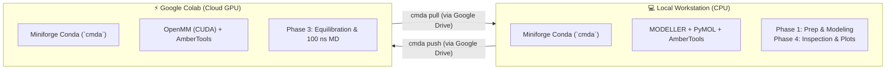

# Installation & Environment Setup

ColabMDA uses a **Hybrid Architecture** that decouples CPU-bound structural preparation from heavy GPU-accelerated molecular dynamics simulations. To maintain simplicity across both environments, the unified conda environment is named **`cmda`**.



---

## 📋 Environment Overview

| Feature | 💻 Local Workstation (`cmda`) | ⚡ Google Colab Cloud Worker (`cmda`) |
| :--- | :--- | :--- |
| **Where it runs** | Your laptop or workstation (Linux, macOS, WSL) | Ephemeral cloud GPU instance (NVIDIA T4 / A100 / L4) |
| **Installed packages** | Python 3.11, MODELLER, Open-Source PyMOL, AmberTools (`tleap`), MDAnalysis, `google-colab-cli`, ColabMDA CLI | Miniforge, OpenMM (CUDA), AmberTools (`tleap`), MDAnalysis, ColabMDA CLI |
| **Interactive prompts** | One prompt for free academic MODELLER key | **Zero prompts** (unattended setup in ~90 seconds) |
| **When to install** | **Do this right now (one-time setup).** | **Run in Phase 3** after launching your Colab GPU instance. |
| **Role in workflow** | **Phase 1:** Structural fetching, homology modeling, point mutations, PROPKA titration, and PyMOL QA.<br/>**Phase 4:** Result retrieval, trajectory visualization, and snapshot grids. | **Phase 3:** 24-stage equilibration ladder, stability QC gating, and 100 ns production MD triplicates. |

---

## 1. Local Workstation Installation

Follow this section to set up your local laptop or desktop. No GPU is required locally.

### 1.1. One-Line Automatic Bootstrap (Recommended)

Run the universal installer in your local terminal. The script detects your operating system, installs Miniforge (if not already installed), provisions the `cmda` conda environment, and configures all dependencies:

```bash
bash -c "$(curl -fsSL https://raw.githubusercontent.com/paulshamrat/ColabMDA/dev1/scripts/setup.sh)"
```

### 1.2. MODELLER Academic License Setup

MODELLER is required during Phase 1 for homology modeling, unresolved loop closure, and *in silico* point mutagenesis. 

* **Obtain a free license key:** Academic licenses are free and sent instantly via email from the Sali Lab registration page: [salilab.org/modeller/registration.html](https://salilab.org/modeller/registration.html).
* **Two ways to provide your license key:**
  1. **Interactive Prompt (Default):** The installation script will pause and prompt you:
     ```text
     Enter your Modeller License Key:
     ```
     Paste your key and press **Enter** to complete configuration.
  2. **Unattended via Environment Variable:** If you prefer non-interactive installation, export the key before running the bootstrap command:
     ```bash
     KEY_MODELLER="YOUR_ACADEMIC_KEY" bash -c "$(curl -fsSL https://raw.githubusercontent.com/paulshamrat/ColabMDA/dev1/scripts/setup.sh)"
     ```

### 1.3. Activate Environment & Authenticate Google Colab CLI

Once installation completes, activate the conda environment and authenticate the Google Colab CLI:

```bash
# 1. Activate the cmda conda environment
source ~/miniforge3/etc/profile.d/conda.sh
conda activate cmda

# 2. Authenticate Google Colab CLI (one-time browser OAuth login)
colab sessions
```

> [!NOTE]
> Running `colab sessions` opens your web browser to authorize the Google Colab CLI to manage your cloud sessions and mount Google Drive. This authorization persists on your workstation.

---

## 2. Developer Installation (Clone from Source)

If you are developing new features, modifying algorithms, or contributing code to ColabMDA, install from a local git checkout:

```bash
# 1. Clone the repository
git clone --branch dev1 https://github.com/paulshamrat/ColabMDA.git ~/ColabMDA
cd ~/ColabMDA

# 2. Run the local setup script with your MODELLER key
KEY_MODELLER="YOUR_ACADEMIC_KEY" bash scripts/setup.sh

# 3. Activate the environment
source ~/miniforge3/etc/profile.d/conda.sh
conda activate cmda

# 4. Install in editable development mode
pip install -e .
```

---

## 3. Running the Automated Test Suite

ColabMDA includes a comprehensive unit and regression test suite under `tests/`. Run tests locally to verify code integrity, force field mechanics, and CLI parsing:

```bash
# Activate environment and navigate to repository root
conda activate cmda
cd ~/ColabMDA

# Run the test suite
pytest tests/ -v
```

*What the test suite validates:*
* **`test_refactor.py`**: Verifies unified `cmda` entrypoints, canonical project paths, and modular execution dispatch.
* **`test_cli.py`**: Verifies argument parsing across all subcommands (`fetch`, `model`, `prep`, `stage`, `sim`, `merge`, `analyze`, `compare`).
* **`test_forcefields.py`**: Verifies Amber ff19SB, OPC water, and 12-6-4 Lennard-Jones ion parameterization.
* **`test_varmdyn_1_24.py`**: Validates the 24-stage progressive heating and restraint release equilibration ladder.
* **`test_security.py`**: Scans the codebase for hardcoded credentials, secret leaks, and security regressions.

---

## 4. Cloud GPU Worker Provisioning (Google Colab)

> [!IMPORTANT]
> **Do not run this step locally.** This step is executed inside the Google Colab cloud environment during **Phase 3** of the tutorials, only after launching your cloud GPU instance.

When running molecular dynamics simulations, ColabMDA utilizes Google Colab's cloud GPUs (Tesla T4, A100, or L4). Because Google Colab virtual machines are ephemeral (they spin up on demand and reset when terminated), you provision the cloud worker environment when connecting to a newly launched instance.

### 4.1. Accessing Your Colab GPU Instance

You can access your Colab GPU instance using either the local command line or the web browser:

* **Option A: Via Local Terminal & Colab CLI (Recommended):**
  ```bash
  # Launch a persistent GPU instance and mount Google Drive
  colab new -s my-sim --gpu T4
  colab drivemount --session my-sim

  # Connect to the remote console terminal
  colab console -s my-sim
  ```
* **Option B: Via Google Colab Web Interface:**
  1. Open [colab.research.google.com](https://colab.research.google.com) in your browser.
  2. Select **Runtime → Change runtime type → T4 GPU**.
  3. Mount Google Drive by running `from google.colab import drive; drive.mount('/content/drive')`.
  4. Open the terminal panel via **⋮ → Terminal**.

### 4.2. Executing the Cloud Worker Bootstrap

Inside the remote Colab console or web terminal, execute the cloud provisioning command:

```bash
# 1. Provision the scientific environment (~90 seconds, unattended)
curl -fsSL https://raw.githubusercontent.com/paulshamrat/ColabMDA/dev1/scripts/setup.sh | bash

# 2. Activate environment in current shell session
source /root/miniforge3/etc/profile.d/conda.sh
conda activate cmda
```

### 4.3. Why Cloud Setup Requires Zero Prompts

* The installer automatically detects that it is executing inside a Google Colab virtual machine (`/content` exists).
* Because homology modeling, loop reconstruction, and PyMOL inspection are already completed locally during Phase 1, MODELLER and PyMOL are automatically omitted on the cloud (`WITH_MODELLER=0`, `WITH_PYMOL=0`).
* The cloud installer provisions only Miniforge, CUDA-enabled OpenMM, AmberTools (`tleap`), MDAnalysis, and ColabMDA.
* The script runs **completely unattended in ~90 seconds with zero interactive prompts or license questions**.

---

## 5. Verification & Troubleshooting

### 5.1. Quick Environment Verification

To verify that the scientific libraries and CLI entrypoints are correctly installed, run:

```bash
# Check CLI entrypoints
cmda --help
colabmda --help

# Verify Python package versions
python3 -c "import openmm, Bio, MDAnalysis; print('OpenMM:', openmm.__version__, '| MDAnalysis:', MDAnalysis.__version__, '| Biopython:', Bio.__version__)"
```

### 5.2. Common Troubleshooting Steps

* **`conda: command not found`:**
  Ensure the conda shell initialization script is sourced in your active shell:
  ```bash
  source ~/miniforge3/etc/profile.d/conda.sh
  conda activate cmda
  ```
  To make this automatic, add `source ~/miniforge3/etc/profile.d/conda.sh` to your `~/.bashrc` or `~/.zshrc`.

* **Updating or Correcting a MODELLER License Key:**
  If you entered an incorrect license key during setup, update it directly in the MODELLER configuration file:
  ```bash
  # Locate the config file and edit the license key string
  python3 -c "import modeller.config as c; print(c.__file__)"
  ```
  Open the printed file path in a text editor and replace the `license = "..."` value with your valid academic key.

* **GPU Detection on Cloud Worker:**
  If OpenMM fails to detect the CUDA platform on Colab, confirm GPU visibility:
  ```bash
  nvidia-smi
  python3 -c "from openmm import Platform; print([Platform.getPlatform(i).getName() for i in range(Platform.getNumPlatforms())])"
  ```
  Ensure `'CUDA'` is listed among the available platforms.
