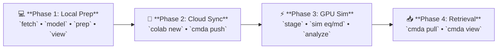

# CDKL5 Apo State: Complete Step-by-Step Walkthrough

This tutorial provides the complete, end-to-end simulation workflow for the **Apo state** (unliganded protein in water) using human cyclin-dependent kinase-like 5 (**CDKL5**, UniProt **O76039**, PDB **4BGQ** Chain A, residues **1–303**) with Wild-Type (WT) and the disease-associated mutant **L119R** as the comparative pair.



> [!NOTE]
> **Prerequisites & Installation:** Before beginning, ensure the `cmda` conda environment is installed on your local machine. For full multi-platform installation instructions, see the [Installation Guide](../installation.md).

---

## 📁 Apo Directory Architecture Map

ColabMDA creates and populates a deterministic directory hierarchy inside `data/apo/` across the four phases:

```text
research/projects/cmda-example/
└── data/
    └── apo/
        ├── structure/
        │   └── O76039_4BGQ/              # Target: UniProt O76039 + Structural Template PDB 4BGQ
        │       ├── raw/                  # Phase 1.2: 4bgq.cif, template.pdb, uniprot.fasta, residues.json
        │       ├── variants/             # Phase 1.3: Modeled backbones (WT/WT.pdb, L119R/L119R.pdb)
        │       └── STRUCTURE_DONE        # Verification QC gate
        │
        ├── simulation/
        │   ├── WT/
        │   │   ├── 01_prep/              # Step 1: system.xml, integrator.xml, model.pdb
        │   │   ├── 02_eq/                # Step 2: eq.pdb, system.xml, state.xml, qc.png, qc.txt, stages/
        │   │   └── 03_md/                # Step 3: Production replicas (100 ns)
        │   │       ├── r1/               # md.dcd, md.log, state.xml, chunks/0001.dcd
        │   │       ├── r2/               # Independent velocity seed
        │   │       └── r3/               # Triplicate simulation
        │   └── L119R/
        │       ├── 01_prep/
        │       ├── 02_eq/
        │       └── 03_md/{r1, r2, r3}/
        │
        └── analysis/                     # Phase 4: Generated during merge, analyze & compare
            ├── WT/                       # 02_eq/ (qc.png, qc.txt), 03_md/ (r1, r2, r3)
            ├── L119R/
            └── compare/                  # Flat comparison: rmsd.png, rg.png, rmsf.png, summary.txt
```

> [!NOTE]
> * **Phase 1** populates `structure/` (raw templates and Modeller variants) and `simulation/<variant>/01_prep/` (Amber `tleap` solvated systems).
> * **Phase 2** syncs the entire `data/` tree to Google Drive (`/MyDrive/research/projects/cmda-example/data/`).
> * **Phase 3** runs on Colab GPU, populating `02_eq/` (equilibration) and `03_md/` (checkpoints and trajectories).
> * **Phase 4** retrieves results locally and builds `analysis/` with merged trajectories and publication plots.

---

## 💻 Phase 1: Local Modeling & Structure Preparation (Local Machine)
*Execute this phase on your local laptop or workstation CPU. No GPU is required.*

### 1.1. Initialize Local Project Workspace
```bash
# 1. Create and navigate to your project directory
mkdir -p ~/research/projects/cmda-example
cd ~/research/projects/cmda-example

# 2. Activate local environment
conda activate cmda
```

### 1.2. Structural Fetching & Biological UniProt Mapping
The `cmda fetch` command downloads experimental PDB coordinates, maps canonical UniProt residue numbering, and detects unresolved loop coordinates for subsequent modeling:

```bash
# Fetch CDKL5 kinase domain (residues 1–303)
cmda fetch --state apo --pdb-id 4BGQ --uniprot-id O76039 --range 1 303

# (Optional) Visually inspect the cleaned template in local PyMOL:
pymol data/apo/structure/O76039_4BGQ/raw/template.pdb
```

*What `cmda fetch` generates in `data/apo/structure/O76039_4BGQ/raw/`:*

| File | Purpose | Scientific Role |
| :--- | :--- | :--- |
| **`4bgq.cif`** | Archive Copy | Immutable raw crystallographic record directly from the RCSB PDB archive. |
| **`template.pdb`** | Modeller Input | Stripped monomer coordinates (Chain A) with non-crystallographic waters and buffer additives removed. |
| **`uniprot.fasta`** | Biological Target | Canonical sequence fetched directly from UniProtKB for precise residue numbering. |
| **`residues.json`** | Coordinate Metadata | Residue-by-residue mapping of author PDB numbering to canonical UniProt positions, identifying resolved vs. missing loops. |
| **`input.json`** | Provenance | Machine-readable record containing execution parameters, timestamps, and SHA-256 integrity checksums. |
| **`STRUCTURE_DONE`** | Gate Marker | Verification marker confirming coordinate density and sequence integrity passed all QC gates. |

<details>
<summary>🔍 <b>Click to view example structural verification banner</b></summary>

```text
==============================================================================
 ColabMDA Structural Mapping & Verification
==============================================================================
 UniProt Target:   O76039 (Residues 1–303, Total Length: 960 AA)
 Template PDB:     4BGQ (Chain A, Method: X-RAY DIFFRACTION, Resolution: 2.00 Å)
 Coordinate Gate:  276/303 observed residues resolved (91.1% coordinate density)
 Missing Loops:    27 missing residues identified across 4 loop segment(s):
                   - Loop 1: Res 1–8 (8 residues)
                   - Loop 2: Res 46–52 (7 residues)
                   - Loop 3: Res 163–173 (11 residues)
                   - Loop 4: Res 303–303 (1 residues)
 Template Check:   ✓ All 276 observed residues match Canonical UniProt WT
 Outputs Saved:    data/apo/structure/O76039_4BGQ/
==============================================================================
```

</details>

---

### 1.3. Homology Modeling & Point Mutations (Modeller)
Model the complete Wild-Type coordinates, closing all 27 missing loop residues, then introduce point mutations on the verified WT backbone:

```bash
# 1. Build full Wild-Type model (UniProt canonical, fills all 27 missing loop residues)
cmda model --state apo --variant WT

# 2. Visually inspect the modeled WT structure in PyMOL:
pymol data/apo/structure/O76039_4BGQ/variants/WT/WT.pdb

# 3. Build Point Mutant (L119R) on the verified WT backbone
cmda model --state apo --variant L119R

# 4. Compare WT and Mutant (L119R) side-by-side in PyMOL:
pymol data/apo/structure/O76039_4BGQ/variants/WT/WT.pdb data/apo/structure/O76039_4BGQ/variants/L119R/L119R.pdb
```

> [!TIP]
> **PyMOL Model Verification Checks**:
> * **Loop Closure Check**: In `WT.pdb`, confirm that residues 163–173 (activation loop) and 46–52 are modeled continuously as an unbroken cartoon ribbon.
> * **Mutation Rotamer Check**: In the WT vs. L119R comparison, enter `zoom resi 119` and `show sticks, resi 119` in PyMOL. Verify that Arg119 is oriented outward into solvent without steric clashes with neighboring helices.

*What happens behind the scenes:*
* **Engineered Template Mutations**: If crystallographers introduced mutations into the PDB template, `cmda fetch` detects them, and Modeller automatically reverts them to canonical UniProt WT during `cmda model WT`.
* **`cmda model WT`**: Invokes Modeller to build full coordinates for residues 1–303, closing missing loops and preserving author residue numbering.
* **`cmda model L119R`**: Introduces the point mutation onto the verified WT template and optimizes local sidechain rotamers.

---

### 1.4. Structure Preparation & Solvation (`tleap` + PROPKA at pH 7.4)
Prepare the solvated systems locally using CPU-bound AmberTools. By default, ColabMDA neutralizes system charge with counterions only:

```bash
# Solvate with OPC water, neutralize net charge, assign AMBER titratable protonation states
cmda prep --state apo --variant WT
cmda prep --state apo --variant L119R

# Visually inspect the solvated systems in PyMOL (WT and Mutant):
pymol data/apo/simulation/WT/01_prep/solvated.pdb
pymol data/apo/simulation/L119R/01_prep/solvated.pdb

# Optional: Add 150 mM physiological saline if specifically desired:
# cmda prep --state apo --variant WT --salt 0.15
```

> [!TIP]
> **PyMOL Solvation & Neutrality Check**:
> Open `solvated.pdb` in PyMOL to verify box dimensions and ion distribution:
> * **Water Box Buffer**: Verify the water box provides at least ~14 Å clearance around the protein edges.
> * **Counterions**: Run `select ions, resn CL- or resn NA+` followed by `show spheres, ions` to ensure neutralizing counterions are solvated in bulk water without steric overlaps.

*Key outputs generated in `data/apo/simulation/<variant>/01_prep/`:*
* `model.pdb`: Immutable copy of the input coordinate PDB for complete reproducibility.
* `solvated.pdb`: Solvated coordinate PDB with protein, water box, and neutralized counterion(s).
* `system.prmtop`: Amber topology containing all `ff19SB` physical parameters.
* `system.inpcrd`: Solvated, charge-neutralized initial coordinates.
* `protonation_summary.json`: Audit log of explicit protonation states assigned by PROPKA at pH 7.4.

#### In-Context Reference: Explicit AMBER Protonation States (PROPKA 3 at pH 7.4)
Accurate protonation states are critical for biophysical fidelity. ColabMDA natively integrates **PDBFixer**, **PDB2PQR**, and **PROPKA 3** during `cmda prep` to evaluate 3D electrostatic microenvironments and assign explicit AMBER titratable residue forms:

| Residue Type | Code | Physical Description & Protonation Criteria |
| :--- | :--- | :--- |
| **Histidine** | `HID` | Neutral Histidine protonated exclusively at $\text{N}_\delta$. |
| | `HIE` | Neutral Histidine protonated exclusively at $\text{N}_\epsilon$ (most common neutral form). |
| | `HIP` | Doubly protonated, positively charged Histidine (both nitrogens protonated, $pK_a > 7.4$). |
| **Acidic** | `ASP` / `GLU` | Negatively charged carboxylate forms (standard physiological state). |
| | `ASH` / `GLH` | Neutral protonated carboxylic acid forms (assigned when local microenvironment $pK_a > 7.4$). |
| **Basic** | `LYS` / `ARG` | Positively charged forms (standard physiological state). |
| | `LYN` | Neutral deprotonated Lysine (assigned when buried in hydrophobic core with $pK_a < 7.4$). |
| **Cysteine** | `CYS` | Free neutral thiol form. |
| | `CYX` | Disulfide-bridged Cysteine form. |

*Audit Manifest:* Every assignment is permanently recorded in `data/apo/simulation/<variant>/01_prep/protonation_summary.json`.

---

### 1.5. Visual Quality Assurance in Local PyMOL
Verify coordinates and the solvated water box interactively before uploading:

```bash
# 1. Inspect modeled coordinates (WT and Mutant):
cmda view --state apo --variant WT
cmda view --state apo --variant L119R

# 2. Compare WT and Mutant side-by-side in PyMOL:
pymol data/apo/structure/O76039_4BGQ/variants/WT/WT.pdb data/apo/structure/O76039_4BGQ/variants/L119R/L119R.pdb

# 3. Inspect the fully solvated systems (water box + neutralizing counterions):
pymol data/apo/simulation/WT/01_prep/solvated.pdb
pymol data/apo/simulation/L119R/01_prep/solvated.pdb
```
*Visual Check:* Confirm loop 163–173 is closed smoothly, Arg119 points into solvent with zero steric clashes, and the OPC water box has adequate padding (~14 Å).

---

## 🚀 Phase 2: Launch Colab GPU & Stream Data to Drive
*Now that your models and solvated Amber parameters are built and verified locally, launch your Colab GPU instance and stream the coordinates to Google Drive.*

In your local terminal:

```bash
# 1. Launch a persistent Colab GPU instance
colab new -s cmda-example --gpu T4

# 2. Mount Google Drive (visit the printed OAuth URL once, then press Enter)
colab drivemount --session cmda-example

# 3. Stream local data/ directly to Google Drive in ONE single command:
cmda push -s cmda-example
```

> [!TIP]
> **Where does `cmda push` upload your files?**
> * **Google Drive Web UI ([drive.google.com](https://drive.google.com)):**  
>   `My Drive` > `research` > `projects` > `cmda-example` > `data/`
> * **Google Colab Filesystem Path:**  
>   `/content/drive/MyDrive/research/projects/cmda-example/data/`
> * **How It Works Under the Hood:** Packages your local `data/` folder (~12 MB), streams it through your active Colab VM (`-s cmda-example`), and extracts it directly into your mounted Google Drive project directory in ~3 seconds with zero browser drag-and-drop.

---

## ⚡ Phase 3: Cloud GPU Simulation & Analysis (Google Colab)
*Connect to Google Colab to run heavy OpenMM molecular dynamics simulations on an NVIDIA GPU.*

### 3.1. Connect to Colab GPU Console
In your local terminal:
```bash
colab console -s cmda-example
```

Inside the interactive Colab console terminal, run the cloud bootstrap *(see the [Installation Guide](../installation.md#2-cloud-gpu-worker-provisioning-google-colab) for details)*:

```bash
# A. One-Time Cloud Setup (unattended in ~90s, zero license prompts):
curl -fsSL https://raw.githubusercontent.com/paulshamrat/ColabMDA/dev1/scripts/setup.sh | bash

# B. Activate Cloud Environment & Navigate to Drive Project:
source /root/miniforge3/etc/profile.d/conda.sh
conda activate cmda

cd /content/drive/MyDrive/research/projects/cmda-example
```

---

### 3.2. Stage Simulation Hubs & 24-Stage Equilibration
Stage the simulation directories and execute the 24-stage progressive heating and restraint release ladder (EM, NVT heating, NPT density relaxation) on CUDA GPU:

```bash
# 1. Initialize simulation directories
cmda stage --state apo --variant WT
cmda stage --state apo --variant L119R

# 2. Run full 24-stage equilibration for WT (automatically executes EM -> NVT -> NPT -> QC)
cmda sim eq --state apo --variant WT

# 3. Run full 24-stage equilibration for L119R (automatically executes EM -> NVT -> NPT -> QC)
cmda sim eq --state apo --variant L119R

# (Optional) Re-run standalone QC gating without re-simulating:
# cmda sim qc --state apo --variant WT
# cmda sim qc --state apo --variant L119R
```

---

### 3.2.1. Intermediate Inspection Gate: Pull & PyMOL Visual Verification (Local Machine)
*Before committing cloud compute to 100 ns production runs, verify that the 24-stage equilibration completed stably and that the protein maintained its folded conformation.*

#### Step 1: Pull Equilibration Deliverables to Local Machine
From your **local workstation terminal**:
```bash
cd ~/research/projects/cmda-example
cmda pull -s cmda-example
```
*This downloads the lightweight `02_eq/` deliverables (`eq.pdb`, `qc.png`, `qc.txt`) to your workstation in seconds.*

#### Step 2: Inspect Convergence Plot & Statistics
Review the gatekeeper outputs for both variants:
* **Wild-Type (WT):**
  * Open `data/apo/simulation/WT/02_eq/qc.png`: Confirms temperature stabilized at $300\text{ K}$ and system density converged to explicit-solvent range ($1.00\text{--}1.02\text{ g/mL}$) with a flat slope.
  * Inspect `data/apo/simulation/WT/02_eq/qc.txt`: Confirms `Status: PASSED`.
* **Mutant (L119R):**
  * Open `data/apo/simulation/L119R/02_eq/qc.png`: Confirms temperature stabilized at $300\text{ K}$ and system density converged ($1.00\text{--}1.02\text{ g/mL}$) with a flat slope.
  * Inspect `data/apo/simulation/L119R/02_eq/qc.txt`: Confirms `Status: PASSED`.

#### Step 3: Inspect Backbone Relaxation in PyMOL (GUI)
Open PyMOL to verify that each protein relaxed without unfolding or distortion:
1. Launch PyMOL on your local computer: `pymol`
2. **Load initial and equilibrated structures via menu**:
   * For **WT**:
     * **`File`** $\to$ **`Open...`** $\to$ select `data/apo/simulation/WT/01_prep/model.pdb`
     * **`File`** $\to$ **`Open...`** $\to$ select `data/apo/simulation/WT/02_eq/eq.pdb`
   * For **L119R**:
     * **`File`** $\to$ **`Open...`** $\to$ select `data/apo/simulation/L119R/01_prep/model.pdb`
     * **`File`** $\to$ **`Open...`** $\to$ select `data/apo/simulation/L119R/02_eq/eq.pdb`
3. **Clean up display (right panel buttons)**:
   * Next to `(all)`: click **`H`** (Hide) $\to$ **`waters`**
   * Next to `(all)`: click **`S`** (Show) $\to$ **`as`** $\to$ **`cartoon`**
4. **Distinguish structures by color**:
   * Next to `model`: click **`C`** (Color) $\to$ **`reds`** $\to$ **`salmon`**
   * Next to `eq`: click **`C`** (Color) $\to$ **`cyans`** $\to$ **`cyan`**
5. **Align them**:
   * Next to `eq`: click **`A`** (Action) $\to$ **`align`** $\to$ **`to molecule`** $\to$ choose **`model`**
6. *Visual Check:* Confirm that the post-equilibration structure (`eq`, cyan) closely overlaps the starting model (`model`, salmon), indicating stable equilibration with preserved secondary structure and no unphysical deformations. Repeat for L119R.

*Once verified, proceed to launch Production MD (Section 3.3).*

---

### 3.3. Production MD Across Triplicates (`03_md/{r1, r2, r3}`)
Replicas fork from `02_eq/` with distinct random velocity seeds into `03_md/`:

```bash
# Wild-Type Triplicates (100 ns production runs)
cmda sim md --state apo --variant WT --replica r1 --total-ns 100
cmda sim md --state apo --variant WT --replica r2 --total-ns 100
cmda sim md --state apo --variant WT --replica r3 --total-ns 100

# Mutant Triplicates (100 ns production runs)
cmda sim md --state apo --variant L119R --replica r1 --total-ns 100
cmda sim md --state apo --variant L119R --replica r2 --total-ns 100
cmda sim md --state apo --variant L119R --replica r3 --total-ns 100
```

#### In-Context Reference: Simulation Math & Storage Budgeting
Use this formula to calculate expected trajectory frames:
$$\text{Expected Frames} = \frac{\text{Total Time (ps)}}{\text{Trajectory Saving Interval (ps)}}$$

* **Example:** A $100.0\text{ ns}$ ($100,000\text{ ps}$) simulation with a $10.0\text{ ps}$ saving interval:
  $$\text{Expected Frames} = \frac{100,000\text{ ps}}{10\text{ ps}} = 10,000\text{ frames}$$
* **Saving Every $10\text{ ps}$ (`--traj-interval 10`):** Reduces total raw storage from **~36 GB to ~3.6 GB (a 90% space reduction)** while still providing 10,000 high-resolution frames per replica—more than sufficient for publication-grade RMSD, RMSF, PCA, and cross-correlation analysis.
* **Stripped Trajectories (`cmda merge`):** Stripping OPC water and bulk ions leaves only protein coordinates (~2,600 atoms), reducing merged trajectory sizes to **<200 MB** per replica!

#### 💡 How to Resume After a Google Colab Timeout
Production MD writes periodic checkpoints (`prod.chk`) directly to Google Drive. If your session expires:

1. Re-launch the session and re-mount Drive from your local terminal:
   ```bash
   colab new -s cmda-example --gpu T4
   colab drivemount --session cmda-example
   colab console -s cmda-example
   ```
2. In the Colab console, re-activate the environment:
   ```bash
   [ ! -d "/root/miniforge3/envs/cmda" ] && curl -fsSL https://raw.githubusercontent.com/paulshamrat/ColabMDA/dev1/scripts/setup.sh | bash
   source /root/miniforge3/etc/profile.d/conda.sh
   conda activate cmda
   cd /content/drive/MyDrive/research/projects/cmda-example
   ```
3. Re-run the exact same `cmda sim md` command:
   ```bash
   cmda sim md --state apo --variant WT --replica r1 --total-ns 100
   ```
   *ColabMDA detects the existing `prod.chk` checkpoint on Google Drive and seamlessly resumes dynamics from the exact last saved timestep with zero data loss.*

#### Trajectory Integrity Auditing (`cmda status`)
To verify chunk continuity, frame counts, and resume readiness before or after merging:
```bash
cmda status --state apo --variant WT --replica r1
```

<details>
<summary>🔍 <b>Click to view example status report</b></summary>

```text
[STATUS]
  Workdir          : data/apo/simulation/WT/03_md/r1
  Chunks (DCD/log) : 100 / 100
  Topology File    : solvated.pdb
                     └─ 27273 atoms, 8388 residues
                     └─ (169 protein, 8170 water, 49 ions)
  Trajectory File  : md.dcd (10000 frames)
  Log File         : md.log (10000 frames)
  Frames (from logs): 10000
  Sim time (ps/ns) : 100000.00 ps / 100.0000 ns (from chunk names)
  Resume-ready     : YES (needs prod.chk, system.xml, solvated.pdb)
```

</details>

Alternatively, query frame counts directly in Python with MDAnalysis:
```bash
python3 -c "import MDAnalysis as mda; u = mda.Universe('data/apo/simulation/WT/03_md/r1/stripped.prmtop', 'data/apo/simulation/WT/03_md/r1/prod_keep_ligand.dcd'); print('Frames:', len(u.trajectory))"
```

---

### 3.4. Merge Trajectories & Autoimage PBC
Merge raw 1-ns chunked trajectories into a single continuous file, re-center the protein in the periodic unit cell (`autoimage`), and strip bulk solvent:

```bash
# Merge Wild-Type replicas
cmda merge --state apo --variant WT

# Merge Mutant replicas
cmda merge --state apo --variant L119R
```

*What `cmda merge` outputs in `data/apo/simulation/<variant>/03_md/<replica>/`:*
* `md.dcd`: Clean continuous trajectory merged from `chunks/0001.dcd` ... `chunks/0100.dcd`.
* `md.log`: Continuous merged thermodynamic log table.
* `state.xml`: Final OpenMM physical restart state.

---

### 3.5. Trajectory Analysis & Direct Overlay Comparison
Run biophysical trajectory analysis and generate publication-ready comparative overlay plots (WT vs. Mutant):

```bash
# 1. Single-variant analysis (RMSD, Radius of Gyration, RMSF)
cmda analyze --state apo --variant WT
cmda analyze --state apo --variant L119R

# 2. Direct comparative overlay (WT vs L119R with Mean ± SD band)
cmda compare --state apo --variants WT,L119R
```

Outputs saved directly in `data/apo/analysis/compare/`:
* `summary.txt` (Executive summary table with Mean ± SD for RMSD, Rg, Temp)
* `rmsd.png` (300 DPI comparative time-series with Mean ± SD band)
* `rg.png` (Radius of Gyration compactness comparison)
* `rmsf.png` (Residue-by-residue fluctuation profiles highlighting loop flexibility)

---

## 📥 Phase 4: Retrieve Results in ONE Command & PyMOL Visualization
*Switch back to your local workstation terminal.*

### 4.1. Pull Analyzed Data from Cloud
Download all analyzed figures, JSON metrics, and lightweight stripped trajectories:

```bash
cmda pull -s cmda-example
```

> [!TIP]
> **What `cmda pull` Does Automatically:**
> 1. Packages analysis CSVs, logs, summary manifests, and 300 DPI PNG plots from Google Drive.
> 2. Excludes heavy raw trajectory files (`.dcd`, `.chk`) by default so the download finishes in ~2 seconds.
> 3. Extracts everything directly into your local `data/` folder.
> 4. Cleans up temporary cloud archives.
>
> *(To download full multi-gigabyte raw trajectories as well, pass `--all`: `cmda pull -s cmda-example --all`).*

### 4.2. In-Context Reference: Topology Pairing Guidelines

When visualizing or analyzing trajectories, the reference topology file used must match the coordinates in the trajectory file:

| Trajectory File | Description | Matching Topology File | Atom Count | Intended Usage |
| :--- | :--- | :--- | :--- | :--- |
| `prod_raw.dcd` | Raw chunked coordinates | `01_prep/solvated.pdb` or `system.prmtop` | ~27,000 atoms | Raw simulation checkpointing & resume. |
| `prod_keep_ligand.dcd` | Merged, PBC autoimaged, water-stripped | `03_md/r1/stripped.prmtop` | ~2,600 atoms | Standard biophysical analysis (`cmda analyze`, `cmda compare`). |
| `prod_ca.dcd` | Merged $C_\alpha$ backbone only | `03_md/r1/ca.prmtop` | ~300 atoms | Rapid PCA and essential dynamics. |

> [!WARNING]
> **Critical PyMOL Topology Warning:**  
> If you load `prod_keep_ligand.dcd` (~2,600 atoms) with `solvated.pdb` (~27,000 atoms) in PyMOL or MDAnalysis, the software will crash with a **fatal atom mismatch error**. Always pair stripped trajectories with `stripped.prmtop`.

### 4.3. Visualizing Trajectories in Local PyMOL
```bash
# 1. View Wild-Type production trajectory in local PyMOL:
cmda view --state apo --variant WT --replica r1

# 2. View Mutant (L119R) production trajectory in local PyMOL:
cmda view --state apo --variant L119R --replica r1

# Generate comparative 3x8 transition snapshot grids:
cmda snapshots --state apo
```

Custom snapshot grids can also be produced using camera configuration JSON:
```json
{
  "camera": {
    "pos": [0.0, 0.0, -100.0],
    "clip": [50.0, 150.0],
    "fov": 20.0
  },
  "states": ["apo"],
  "variants": ["WT", "L119R"],
  "output": "data/apo/figures/custom_grid.png"
}
```
Run with:
```bash
cmda snapshots --config camera_config.json
```

---

## Acknowledgements
- [OpenMM](https://openmm.org) & [PDBFixer](https://github.com/openmm/pdbfixer)
- [Modeller](https://salilab.org/modeller/)
- [MDAnalysis](https://www.mdanalysis.org) & [MDTraj](https://www.mdtraj.org)
- [PDB2PQR & PROPKA](https://server.poissonboltzmann.org/)
- [NumPy](https://numpy.org), [Matplotlib](https://matplotlib.org), [Biopython](https://biopython.org)
- [Google Colab](https://colab.research.google.com) & [Miniforge/Conda](https://github.com/conda-forge/miniforge)

---

## Citation

Initially, this repository was based on a GROMACS-on-Colab workflow, but was transitioned to OpenMM to improve performance and stability for automated simulation recovery on cloud platforms.

If you use this tool, please cite the underlying studies:

> Paul SK, Saddam M, Rahaman KA, Choi JG, Lee SS, Hasan M. **Molecular modeling, molecular dynamics simulation, and essential dynamics analysis of grancalcin: An upregulated biomarker in experimental autoimmune encephalomyelitis mice.** *Heliyon*. 2022 Oct 23;8(10):e11232. doi: [10.1016/j.heliyon.2022.e11232](https://doi.org/10.1016/j.heliyon.2022.e11232). PMID: 36340004; PMCID: PMC9626934.
>
> [](https://doi.org/10.1016/j.heliyon.2022.e11232)
>
> Paul SK, Saddam M, Tabassum N, Hasan M. **Molecular dynamics simulation of wild and mutant proteasome subunit beta type 8 (PSMB8) protein: Implications for restoration of inflammation in experimental autoimmune encephalomyelitis pathogenesis.** *Heliyon*. 2024 Dec 15;11(1):e41166. doi: [10.1016/j.heliyon.2024.e41166](https://doi.org/10.1016/j.heliyon.2024.e41166). PMID: 39802026; PMCID: PMC11719297.
>
> [](https://doi.org/10.1016/j.heliyon.2024.e41166)

