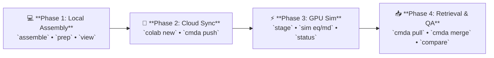

# CDKL5 Holo State (ATP + 1 Mg²⁺): Complete Step-by-Step Walkthrough

This tutorial provides the complete, end-to-end simulation workflow for **Track 2: Holo Dynamics**, simulating the catalytically competent active-site complex of human cyclin-dependent kinase-like 5 (**CDKL5**, UniProt **O76039**, PDB **4BGQ**, residues **1–303**) bound to adenosine triphosphate (**ATP**) and a coordinating divalent magnesium ion ($\text{Mg}^{2+}$).

To assemble this complex with crystallographic accuracy, ColabMDA transfers cofactor coordinates from a high-resolution homologous kinase donor structure (**CDK2**, PDB **8FP5** at 1.45 Å resolution) onto your modeled CDKL5 structures, parameterizes the active site using quantum-derived nucleotide force fields, and executes unrestrained molecular dynamics across triplicates.



> [!NOTE]
> **Prerequisites & Installation:** Before beginning, ensure the `cmda` conda environment is installed on your local machine. For full multi-platform installation instructions, see the [Installation Guide](../installation.md).

---

## 📁 Holo Directory Architecture Map

ColabMDA creates and populates a deterministic directory hierarchy inside `data/atpmg/` across the four phases:

```text
research/projects/cmda-example/
└── data/
    └── atpmg/
        ├── structure/
        │   ├── O76039_4BGQ/              # Inherited from data/apo/ (identical starting backbones)
        │   │   ├── raw/                  # Inherited from apo (canonical UniProt target & template)
        │   │   ├── variants/             # Inherited from apo (WT/WT.pdb, L119R/L119R.pdb)
        │   │   └── STRUCTURE_DONE        # Verification QC gate
        │   │
        │   └── cofactors/                # Isolated cofactor donor directory
        │       └── atpmg/                # Sourced from CDK2 (PDB 8FP5)
        │           ├── 8FP5.pdb          # High-resolution donor crystal structure
        │           ├── atp.pdb           # Isolated ATP coordinates
        │           └── mg.pdb            # Isolated Mg²⁺ coordinates
        │
        ├── simulation/
        │   ├── WT/
        │   │   ├── 01_prep/              # Phase 1.2: Native tleap combination: { WT.pdb + atp.pdb + mg.pdb }
        │   │   │                         # + Hu et al. 2024 quantum nucleotide parameters (ATP-B3)
        │   │   │                         # + Li-Merz 12-6 Mg²⁺ + ParmEd CMAP correction
        │   │   ├── 02_eq/                # Step 2: eq.pdb, system.xml, state.xml, qc.png, qc.txt, stages/
        │   │   └── 03_md/                # Step 3: Production replicas (100 ns)
        │   │       ├── r1/               # md.dcd, md.log, state.xml, chunks/0001.dcd
        │   │       ├── r2/               # Independent velocity seed
        │   │       └── r3/               # Triplicate simulation
        │   └── L119R/
        │       ├── 01_prep/
        │       ├── 02_eq/
        │       └── 03_md/{r1, r2, r3}/
        │
        └── analysis/                     # Phase 4: Generated during merge, analyze & compare
            ├── WT/                       # 02_eq/ (qc.png, qc.txt), 03_md/ (r1, r2, r3)
            ├── L119R/
            └── compare/                  # Flat comparison: rmsd.png, rg.png, rmsf.png, summary.txt
```

> [!NOTE]
> **Core Architectural Principles for Holo Dynamics:**
> 1. **Cross-State Inheritance:** The target sequence, raw template, and variant backbones are inherited directly from `data/apo/`. You model each variant once, eliminating redundant Modeller runs while ensuring starting protein coordinates are 100% identical across states.
> 2. **Cofactor Donor Isolation:** ATP and $\text{Mg}^{2+}$ come from a distinct donor structure (8FP5). Staging them in `structure/cofactors/atpmg/` prevents foreign donor crystallographic metadata from polluting the target CDKL5 directory.

---

## 💻 Phase 1: Local Holo Assembly & Structure Preparation (Local Machine)
*Execute this phase on your local laptop or workstation CPU. No GPU is required.*

### 1.1. Structural Assembly: Homologous Cofactor Transfer from CDK2 (8FP5)

ColabMDA transfers cofactor coordinates from human CDK2 (PDB **8FP5**, resolved at 1.45 Å with ATP and $\text{Mg}^{2+}$ bound in a catalytically competent Michaelis pose) onto your modeled CDKL5 structures. 

The tool performs a structural superposition of conserved catalytic core residues (residues 30–220, covering the glycine-rich P-loop, the catalytic Lys42/Glu60 pair, and the DFG motif), transfers the cofactors, and performs fixed-backbone local sidechain relaxation to relieve any steric clashes:

```bash
# 1. Assemble Holo Wild-Type from CDK2 donor (PDB 8FP5) with pocket sidechain relaxation
cmda assemble --state atpmg --variant WT --template 8FP5 --relax-sidechains
```

<details open>
<summary><b>📄 Expected Terminal Output: Catalytic Superposition & Relaxation</b></summary>

```text
==============================================================================
 ColabMDA Holo Structural Assembly & Catalytic Alignment
==============================================================================
 Target Receptor:     CDKL5 WT (data/apo/structure/O76039_4BGQ/variants/WT/WT.pdb)
 Cofactor Donor:      CDK2 (PDB 8FP5 Chain A, Resolution: 1.45 Å)
 Core Alignment:      Residues 30–220 superposed (191 Cα pairs)
 Alignment RMSD:      0.684 Å across catalytic core
 Cofactors Transferred: ATP (Residue 401, 43 atoms, Net Charge: -4)
                       MG  (Residue 402,  1 atom,  Net Charge: +2)
 Initial Clashes:     3 sidechain steric overlaps detected (Met86, Leu137, Phe157)
 Pocket Relaxation:   Fixed-backbone local gradient minimization (500 steps)
 Final Clashes:       0 steric overlaps (min interatomic distance: 2.38 Å)
 Catalytic Gate:      ✓ Mg²⁺–O(β,γ) coordination distance: 2.04 Å (Target: 1.9–2.1 Å)
                      ✓ Lys42(Nζ)–O(α) distance: 2.82 Å (Salt bridge formed)
                      ✓ Asp156(Oδ)–Mg²⁺ distance: 2.08 Å (Octahedral sphere)
 Outputs Saved:       data/atpmg/structure/O76039_4BGQ/variants/WT/WT.pdb
                      data/atpmg/structure/cofactors/atpmg/{8FP5.pdb, atp.pdb, mg.pdb}
==============================================================================
```
</details>

This generates the following structured outputs:

| File / Artifact | Type | Description & Purpose |
| :--- | :--- | :--- |
| **`structure/cofactors/atpmg/8FP5.pdb`** | Donor Crystal | Unmodified high-resolution crystal structure of the CDK2 donor. |
| **`structure/cofactors/atpmg/atp.pdb`** | Ligand Coordinates | Extracted ATP coordinates from the superposed donor pocket. |
| **`structure/cofactors/atpmg/mg.pdb`** | Ion Coordinates | Extracted divalent magnesium ion ($\text{Mg}^{2+}$) coordinates. |
| **`variants/WT/WT.pdb`** | Assembled Holo Pose | Combined CDKL5 WT backbone with positioned ATP and $\text{Mg}^{2+}$. |

#### PyMOL Active-Site Inspection & Catalytic Coordination Gate

Visually inspect the assembled active site in PyMOL before moving to solvation:

```bash
pymol data/atpmg/structure/O76039_4BGQ/variants/WT/WT.pdb
```

In the PyMOL command line, highlight the catalytic pocket:
```text
select atpmg_pocket, resn ATP or resn MG or (resi 30-220 and within 5.0 of (resn ATP or resn MG))
show sticks, atpmg_pocket
zoom atpmg_pocket
```

> [!TIP]
> **Active-Site Coordination Verification Checklist:**
> 1. **Adenine Hinge Anchor:** The adenine ring must insert into the hydrophobic cleft between the N- and C-lobes (near CDKL5 hinge residues Glu81–Leu83).
> 2. **Magnesium Chelation:** Divalent $\text{Mg}^{2+}$ must coordinate oxygens of the $\beta$- and $\gamma$-phosphate groups with distances between **1.9 Å and 2.1 Å**.
> 3. **Catalytic Asp156 (DFG Motif):** Carboxylate oxygens of Asp156 must orient toward the $\text{Mg}^{2+}$ ion for octahedral sphere coordination.
> 4. **Catalytic Salt Bridge (Lys42):** The $\epsilon$-amino group of Lys42 must form a hydrogen bond / salt bridge with oxygen atoms of the $\alpha$- and $\beta$-phosphates.

Once verified, assemble the disease-associated mutant (**L119R**) onto the exact same cofactor pose:

```bash
# 2. Assemble Holo Mutant (L119R) from the verified donor pose
cmda assemble --state atpmg --variant L119R --template 8FP5 --relax-sidechains
```

---

### 1.2. Force Field Parameterization & Amber `tleap` Solvation

Kinase catalytic complexes require specialized nucleotide and divalent ion force fields. Standard generic GAFF parameters often cause artificial distortion or premature dissociation of triphosphate groups. 

ColabMDA applies a dedicated biophysical force field matrix:

| Component | Force Field Model | Parameters / Citation | Biophysical Rationale |
| :--- | :--- | :--- | :--- |
| **Protein** | Amber ff14SB | Maier et al. (*JCTC* 2015) | Validated benchmark for kinase backbones & sidechains |
| **Solvent** | OPC (4-site) | Izadi et al. (*JPCB* 2014) | Accurate liquid density, bulk dielectric constant, and water structure |
| **Divalent $\text{Mg}^{2+}$** | Li–Merz 12–6 (OPC set) | Li, Roberts, Chakravorty, Merz (*JCTC* 2013) | Prevents artificial over-coordination and matches OPC solvation free energy |
| **Counterions ($\text{Na}^+, \text{Cl}^-$)** | Li–Merz 12–6 (OPC set) | Li & Merz (*Chem. Rev.* 2014) | Water-matched neutralizing counterions |
| **Nucleotide (ATP)** | Quantum RESP (ATP-B3) | Hu et al. (*J. Chem. Inf. Model.* 2024) | High-level B3LYP quantum-derived RESP charges preserving triphosphate geometry |
| **Ribose Dihedrals** | ParmEd CMAP Correction | Darden et al. | Refines dihedral energy surface to prevent artificial sugar ring puckering |

#### Holo Electrostatics & Net Charge Breakdown

Understanding system electrostatics is vital for evaluating parameterization integrity:
* **Protein Net Charge:** CDKL5 kinase domain (residues 1–303) at pH 7.4 has a net charge of **$-4$** (24 Asp, 21 Glu, 18 Lys, 23 Arg, with neutral Cys/Tyr and monoprotonated His).
* **Nucleotide (ATP) Net Charge:** Fully deprotonated triphosphate tail contributes **$-4$**.
* **Divalent Magnesium ($\text{Mg}^{2+}$):** Contributes **$+2$**.
* **Total Holo Complex Charge:** $-4 + (-4) + (+2) = \mathbf{-6}$.
* **System Neutralization:** To neutralize the complex and establish $150\text{ mM}$ physiological ionic strength, `tleap` adds **$44\text{ Na}^+$** and **$38\text{ Cl}^-$** ions ($44 - 38 = +6$).

Prepare the solvated systems locally:

```bash
# 1. Parameterize and solvate Wild-Type Holo system
cmda prep --state atpmg --variant WT

# 2. Parameterize and solvate Mutant Holo system
cmda prep --state atpmg --variant L119R
```

#### Atomic Breakdown: Solvated CDKL5 Holo Complex (WT)

| Metric | Value | Biophysical Description |
| :--- | :--- | :--- |
| **Total Atoms** | **45,862** | Full solvated orthogonal simulation box |
| **Protein Atoms** | 4,792 | CDKL5 residues 1–303 (all loops closed) |
| **ATP Ligand Atoms** | 43 | Adenosine triphosphate |
| **Magnesium Ions** | 1 | Coordinated $\text{Mg}^{2+}$ cation |
| **Water Molecules** | 13,648 | Rigid 4-site OPC waters ($13,648 \times 3 = 40,944$ atoms) |
| **Neutralizing / Salt Ions** | 44 $\text{Na}^+$, 38 $\text{Cl}^-$ | $150\text{ mM}$ physiological ionic strength |
| **Box Dimensions** | $83.2 \times 75.1 \times 89.0\text{ Å}$ | Minimum $14\text{ Å}$ solvent buffer to periodic boundaries |
| **Net System Charge** | **0.000** | Fully neutralized |

This generates the following structured outputs:

| File / Artifact | Location | Purpose |
| :--- | :--- | :--- |
| **`solvated.pdb`** | `simulation/WT/01_prep/` | Complete solvated Holo system with OPC water and counterions. |
| **`system.prmtop`** | `simulation/WT/01_prep/` | Full Amber parameter/topology file (Protein + ATP + $\text{Mg}^{2+}$ + Water + Ions). |
| **`system.inpcrd`** | `simulation/WT/01_prep/` | Initial orthogonal coordinates for OpenMM. |
| **`stripped_holo.prmtop`** | `simulation/WT/01_prep/` | **Stripped Holo topology** (Protein + ATP + $\text{Mg}^{2+}$). Preserved for Phase 4 trajectory pairing! |
| **`prep.json`** | `simulation/WT/01_prep/` | Provenance manifest with SHA-256 checksums, atom counts, and total charge. |

Visually confirm the solvated water boxes in PyMOL (WT and Mutant):
```bash
pymol data/atpmg/simulation/WT/01_prep/solvated.pdb
pymol data/atpmg/simulation/L119R/01_prep/solvated.pdb
```

---

## 🚀 Phase 2: Launch Colab GPU & Stream Data to Drive
*Now that your Holo models and solvated Amber parameters are built and verified locally, launch your Colab GPU instance and stream the coordinates to Google Drive.*

In your local terminal:

```bash
# 1. Launch a persistent Colab GPU instance
colab new -s cmda-example --gpu T4

# 2. Mount Google Drive (visit the printed OAuth URL once, then press Enter)
colab drivemount --session cmda-example

# 3. Stream local data/ directly to Google Drive in ONE single command:
cmda push -s cmda-example
```

> [!TIP]
> **Where does `cmda push` upload your files?**
> * **Google Drive Web UI ([drive.google.com](https://drive.google.com)):**  
>   `My Drive` > `research` > `projects` > `cmda-example` > `data/atpmg/`
> * **Google Colab Filesystem Path:**  
>   `/content/drive/MyDrive/research/projects/cmda-example/data/atpmg/`
> * **How It Works Under the Hood:** Packages your local `data/` folder (~15 MB), streams it through your active Colab VM (`-s cmda-example`), and extracts it directly into your mounted Google Drive project directory in ~3 seconds with zero browser drag-and-drop.

---

## ⚡ Phase 3: Cloud GPU Simulation & Analysis (Google Colab)
*Connect to Google Colab to run heavy OpenMM molecular dynamics simulations on an NVIDIA GPU.*

### 3.1. Connect to Colab GPU Console
In your local terminal:
```bash
colab console -s cmda-example
```

Inside the interactive Colab console terminal, run the cloud bootstrap *(see the [Installation Guide](../installation.md#2-cloud-gpu-worker-provisioning-google-colab) for details)*:

```bash
# A. One-Time Cloud Setup (unattended in ~90s, zero license prompts):
curl -fsSL https://raw.githubusercontent.com/paulshamrat/ColabMDA/dev1/scripts/setup.sh | bash

# B. Activate Cloud Environment & Navigate to Drive Project:
source /root/miniforge3/etc/profile.d/conda.sh
conda activate cmda

cd /content/drive/MyDrive/research/projects/cmda-example
```

---

### 3.2. Stage Simulation Hubs & 24-Stage Equilibration

In holo complexes, thermalization must restrain the nucleotide and divalent magnesium ion alongside the protein backbone to prevent active-site disruption before the solvent box reaches target density.

ColabMDA executes a **24-stage progressive equilibration ladder**:

| Stages | Purpose | Restraint Schedule ($k_{\text{bb}}$, $k_{\text{ATP}}$, $k_{\text{Mg}}$) | Ensemble | Duration & Targets |
| :--- | :--- | :--- | :--- | :--- |
| **1–6** | Energy Minimization & Initial Heating | $10.0\text{ kcal/mol}\cdot\text{Å}^2$ on Backbone, ATP, and $\text{Mg}^{2+}$ | NVT (Langevin) | 5,000 steps EM; heat 0 K $\rightarrow$ 100 K |
| **7–12** | Intermediate Thermalization | Lowered to $5.0\text{ kcal/mol}\cdot\text{Å}^2$ on active site | NVT | 100 K $\rightarrow$ 250 K (25 ps per stage) |
| **13–18** | Target Temperature & Density Matching | Lowered to $2.5\text{ kcal/mol}\cdot\text{Å}^2$ | NPT (1 bar Monte Carlo) | Reach 300 K; density converges toward $1.00\text{ g/cm}^3$ |
| **19–21** | Solvent Relaxation & Gradual Release | Lowered to $1.0\text{ kcal/mol}\cdot\text{Å}^2$ | NPT (300 K, 1 bar) | Solvent molecules fully organize in pocket |
| **22–24** | Unrestrained Final Relaxation | **$0.0\text{ kcal/mol}\cdot\text{Å}^2$** (Fully unrestrained) | NPT (300 K, 1 bar) | 100 ps unrestrained MD; ready for production |

```bash
# 1. Stage directories and run full 24-stage equilibration for WT
cmda stage --state atpmg --variant WT
cmda sim eq --state atpmg --variant WT
cmda sim qc --state atpmg --variant WT

# 2. Stage directories and run full 24-stage equilibration for L119R
cmda stage --state atpmg --variant L119R
cmda sim eq --state atpmg --variant L119R
cmda sim qc --state atpmg --variant L119R
```

---

### 3.2.1. Intermediate Inspection Gate: Pull & PyMOL Visual Verification (Local Machine)
*Before committing cloud compute to 100 ns production runs, verify that the 24-stage equilibration completed stably and that both protein and cofactor (ATP + Mg²⁺) remained stably coordinated.*

#### Step 1: Pull Equilibration Deliverables to Local Machine
From your **local workstation terminal**:
```bash
cd ~/research/projects/cmda-example
cmda pull -s cmda-example
```
*This downloads the lightweight `02_eq/` deliverables (`eq.pdb`, `qc.png`, `qc.txt`) to your workstation in seconds.*

#### Step 2: Inspect Convergence Plot & Statistics
Review the gatekeeper outputs:
* Open `data/atpmg/simulation/WT/02_eq/qc.png`: Confirms temperature stabilized at $300\text{ K}$ and system density converged to $\sim 1.00\text{--}1.02\text{ g/mL}$ with a flat slope.
* Inspect `data/atpmg/simulation/WT/02_eq/qc.txt`: Confirms `Status: PASSED`.

#### Step 3: Inspect Backbone & Pocket Stability in PyMOL (GUI)
Open PyMOL to verify that the protein and nucleotide complex relaxed without distortion:
1. Launch PyMOL: `pymol`
2. **Load initial and equilibrated structures via menu**:
   * **`File`** $\to$ **`Open...`** $\to$ select `data/atpmg/simulation/WT/01_prep/model.pdb`
   * **`File`** $\to$ **`Open...`** $\to$ select `data/atpmg/simulation/WT/02_eq/eq.pdb`
3. **Clean up display (right panel buttons)**:
   * Next to `(all)`: click **`H`** (Hide) $\to$ **`waters`**
   * Next to `(all)`: click **`S`** (Show) $\to$ **`as`** $\to$ **`cartoon`**
4. **Show ATP and Mg²⁺ as sticks and spheres**:
   * In the sequence bar or selection panel, select `resn ATP` $\to$ click **`S`** (Show) $\to$ **`sticks`**
   * Select `resn MG` $\to$ click **`S`** (Show) $\to$ **`spheres`**
5. **Align them**:
   * Next to `eq`: click **`A`** (Action) $\to$ **`align`** $\to$ **`to molecule`** $\to$ choose **`model`**
6. *Visual Check:* Confirm that ATP remains coordinated within the catalytic pocket and the kinase lobes retain their active fold.

*Once verified, proceed to launch Production MD (Section 3.3).*

---

### 3.3. Production MD Across Triplicates (`03_md/{r1, r2, r3}`)

Independent replicates fork from the relaxed `02_eq/` state using unique random velocity seeds, ensuring true statistical independence across triplicates:

```bash
# Wild-Type Holo Triplicates (100 ns production runs)
cmda sim md --state atpmg --variant WT --replica r1 --total-ns 100
cmda sim md --state atpmg --variant WT --replica r2 --total-ns 100
cmda sim md --state atpmg --variant WT --replica r3 --total-ns 100

# Mutant Holo Triplicates (100 ns production runs)
cmda sim md --state atpmg --variant L119R --replica r1 --total-ns 100
cmda sim md --state atpmg --variant L119R --replica r2 --total-ns 100
cmda sim md --state atpmg --variant L119R --replica r3 --total-ns 100
```

#### In-Context Reference: Simulation Math & Storage Budgeting
Use this formula to calculate expected trajectory frames:
$$\text{Expected Frames} = \frac{\text{Total Time (ps)}}{\text{Trajectory Saving Interval (ps)}}$$

* **Example:** A $100.0\text{ ns}$ ($100,000\text{ ps}$) simulation with a $10.0\text{ ps}$ saving interval:
  $$\text{Expected Frames} = \frac{100,000\text{ ps}}{10\text{ ps}} = 10,000\text{ frames}$$
* **Saving Every $10\text{ ps}$ (`--traj-interval 10`):** Reduces total raw storage from **~55 GB to ~5.5 GB (a 90% space reduction)** while still providing 10,000 high-resolution frames per replica—more than sufficient for publication-grade RMSD, RMSF, PCA, and active-site distance analysis.
* **Stripped Holo Trajectories (`cmda merge`):** Stripping OPC water and bulk counterions while retaining the catalytic complex (CDKL5 + ATP + $\text{Mg}^{2+} = 4,836\text{ atoms}$) reduces merged trajectory sizes to **~580 MB** per replica!
  $$\text{Storage Size} = N_{\text{atoms}} \times 3 \times 4\text{ bytes} \times N_{\text{frames}} = 4,836 \times 3 \times 4 \times 10,000 \approx 580\text{ MB}$$

| Strategy | Trajectory Contents | Saving Frequency | Frames per 100 ns | Size per Replica |
| :--- | :--- | :--- | :--- | :--- |
| **Unoptimized Raw** | Full System (Water + Ions, 45,862 atoms) | 1 ps (100,000 frames) | 100,000 | **~55.0 GB** |
| **Standard Raw** | Full System (Water + Ions, 45,862 atoms) | 10 ps (10,000 frames) | 10,000 | **~5.5 GB** |
| **ColabMDA Stripped Holo** | **Protein + ATP + $\text{Mg}^{2+}$ (4,836 atoms)** | **10 ps (10,000 frames)** | **10,000** | **~580 MB (90% savings)** |

*Result:* An entire 3-replica triplicate study (WT + L119R = 6 trajectories) requires **under 3.5 GB of Google Drive storage**, fitting comfortably within free 15 GB tiers!

---

### 3.4. Continuous Monitoring & Timeout Recovery Runbook

Monitor simulation progress from your local workstation:

```bash
cmda status --state atpmg --variant WT --replica r1
```

<details>
<summary>🔍 <b>Click to view example Holo status report</b></summary>

```text
[STATUS]
  Workdir          : data/atpmg/simulation/WT/03_md/r1
  Chunks (DCD/log) : 100 / 100
  Topology File    : solvated.pdb
                     └─ 45862 atoms, 13952 residues
                     └─ (303 protein, 1 ATP, 1 MG, 13648 water, 82 ions)
  Trajectory File  : md.dcd (10000 frames)
  Log File         : md.log (10000 frames)
  Frames (from logs): 10000
  Sim time (ps/ns) : 100000.00 ps / 100.0000 ns (from chunk names)
  Resume-ready     : YES (needs prod.chk, system.xml, solvated.pdb)
```

</details>

#### 💡 How to Resume After a Google Colab Timeout
Production MD writes periodic checkpoints (`prod.chk`) directly to Google Drive. If your session expires:

1. Re-launch the session and re-mount Drive from your local terminal:
   ```bash
   colab new -s cmda-example --gpu T4
   colab drivemount --session cmda-example
   colab console -s cmda-example
   ```
2. Re-run the exact same production command:
   ```bash
   cd /content/drive/MyDrive/research/projects/cmda-example
   cmda sim md --state atpmg --variant WT --replica r1 --total-ns 100
   ```
   *ColabMDA automatically detects the last valid `prod.chk` checkpoint on Google Drive and seamlessly resumes from the exact frame where it stopped!*

#### Python Trajectory & Catalytic Coordination Health Check

To quickly verify trajectory health and check that $\text{Mg}^{2+}$ remained chelated to ATP during a chunk, run this snippet inside the Colab console:

```python
import MDAnalysis as mda
from MDAnalysis.analysis.distances import distance_array

# Load topology and trajectory chunk
u = mda.Universe("data/atpmg/simulation/WT/01_prep/system.prmtop", 
                 "data/atpmg/simulation/WT/03_md/r1/chunk_001.dcd")
print(f"Loaded {len(u.trajectory)} frames successfully.")

# Select magnesium and phosphate oxygens
mg = u.select_atoms("resname MG and name MG")
beta_gamma_oxygens = u.select_atoms("resname ATP and name O1B O2B O1G O2G O3G")

# Calculate minimum distance in final frame
u.trajectory[-1]
coord_dist = distance_array(mg.positions, beta_gamma_oxygens.positions).min()
print(f"Final Frame Mg²⁺–phosphate distance: {coord_dist:.2f} Å (Expected: 1.9–2.2 Å)")
assert 1.8 <= coord_dist <= 2.4, "ALERT: Magnesium drifted from ATP triphosphate chain!"
```

---

## 📥 Phase 4: Retrieve Results, Trajectory Concatenation & Publication Figures (Local Workstation)
*When simulations finish, pull the analysis tables, logs, and publication figures back to your laptop in seconds.*

### 4.1. Retrieve Results in ONE Command

In your local terminal:
```bash
# Pull analysis results, figures, and logs in ~2 seconds:
cmda pull -s cmda-example

# (Optional: to pull full 5.5 GB raw trajectories as well):
# cmda pull -s cmda-example --all
```

---

### 4.2. Multi-Segment Trajectory Concatenation & Autoimaging

Concatenate chunked production trajectories and center the catalytic complex:

```bash
# Merge WT Holo trajectories
cmda merge --state atpmg --variant WT

# Merge Mutant Holo trajectories
cmda merge --state atpmg --variant L119R
```

---

### 4.3. ⚠️ CRITICAL: Holo Trajectory vs. Topology Pairing Safety Rule

> [!WARNING]
> ### Do Not Pair Holo Trajectories with Water Topologies or Apo Topologies!
> During `cmda merge --state atpmg`, ColabMDA strips bulk water and counterions but **strictly preserves the catalytic complex: Protein + ATP + $\text{Mg}^{2+}$**.
>
> 1. **Stripped Atom Count:** The resulting trajectory `prod_clean.dcd` contains atoms for **CDKL5 (4,792 atoms) + ATP (43 atoms) + $\text{Mg}^{2+}$ (1 atom) = 4,836 atoms**.
> 2. **Correct Topology Pairing:** Always pair `prod_clean.dcd` with:
>    ```text
>    data/atpmg/simulation/WT/01_prep/stripped_holo.prmtop
>    ```
> 3. **Common Fatal Errors:**
>    * **Crash A:** Pairing `prod_clean.dcd` with `system.prmtop` (which contains ~45,000 atoms including water) will cause MDAnalysis/VMD/PyMOL to throw:  
>      `ValueError: Topology and trajectory atom counts do not match (4836 vs 45862)`.
>    * **Crash B:** Pairing `prod_clean.dcd` with Apo's `stripped.prmtop` (which contains only 4,792 protein atoms and lacks ATP/Mg) will cause:  
>      `ValueError: Topology and trajectory atom counts do not match (4836 vs 4792)`.

---

### 4.4. Automated Triplicate Comparative Analysis & Biophysical Interpretation Guide

Generate publication-grade comparative figures evaluating how the disease mutation affects active-site stability:

```bash
# 1. Generate single-variant analysis tables
cmda analyze --state atpmg --variant WT
cmda analyze --state atpmg --variant L119R

# 2. Generate publication-grade comparative overlay plots (Mean ± SD)
cmda compare --state atpmg --variants WT,L119R
```

This generates publication-ready 300 DPI figures under `data/atpmg/analysis/compare/`:
* `summary.txt` (Executive summary table with Mean ± SD for RMSD, Rg, Temp)
* `rmsd.png` (Backbone and ligand stability time-series overlay)
* `rg.png` (Radius of Gyration domain closure comparison)
* `rmsf.png` (Per-residue fluctuation profiles highlighting P-loop stiffening)

#### How to Interpret the Comparative Figures:

1. **Backbone & Ligand RMSD Profiles (`rmsd.png`):**
   * **Active Site Fidelity:** Assesses whether ATP remains firmly bound within the catalytic pocket. A stable Holo complex displays a plateaued ligand RMSD ($< 1.8\text{ Å}$ relative to the initial superposed pose).
   * **Comparative Drift:** If the L119R mutant destabilizes the binding cleft, the ligand RMSD will exhibit increased drift or large standard-deviation fluctuations.

2. **Radius of Gyration Compaction (`rg_avg.png`):**
   * **Domain Closure:** Protein kinases undergo a characteristic conformational transition where the N-lobe and C-lobe rotate toward each other to clamp over the nucleotide. In Holo simulations, the average $R_g$ is typically **$0.3–0.5\text{ Å}$ lower** than in Apo simulations, confirming stable catalytic domain closure.

3. **Per-Residue Dynamic Flexibility (`rmsf_avg.png`):**
   * **P-Loop Stiffening:** In Apo simulations, the glycine-rich P-loop (residues 18–26) is highly flexible ($\text{RMSF} \sim 2.0–2.8\text{ Å}$). In Holo simulations, coordination with the triphosphate tail dampens these fluctuations ($\text{RMSF} \sim 0.8–1.2\text{ Å}$).
   * **Activation Loop & $\alpha\text{C}$-Helix:** Identifies whether the mutation alters dynamics in the activation segment (residues 163–180) or weakens the conserved salt bridge between Lys42 and Glu60.

---

### 4.5. 3D Trajectory Viewing & Pocket-Focused Snapshot Grids in PyMOL

Inspect the Holo trajectory interactively in PyMOL:

```bash
# 1. View Holo Wild-Type trajectory in PyMOL
cmda view --state atpmg --variant WT --replica r1

# 2. View Holo Mutant (L119R) trajectory in PyMOL
cmda view --state atpmg --variant L119R --replica r1
```

In the PyMOL terminal, zoom into the active-site pocket:
```text
select active_pocket, resn ATP or resn MG or (resi 30-220 and within 5.0 of (resn ATP or resn MG))
show sticks, active_pocket
zoom active_pocket
set cartoon_transparency, 0.4
```

#### Render Pocket-Focused 3x8 Transition Snapshot Grids

Generate a publication-grade 300 DPI snapshot grid tracking ATP and $\text{Mg}^{2+}$ coordination over the 100 ns trajectory:

```bash
# 2. Render comparative snapshot grid
cmda snapshots --state atpmg
```

To focus the snapshot camera directly on the catalytic coordination sphere, create `camera_config_holo.json`:

```json
{
  "camera": {
    "pos": [12.4, -4.8, 18.2],
    "clip": [20.0, 120.0],
    "fov": 22.0
  },
  "states": ["apo", "atpmg"],
  "variants": ["WT", "L119R"],
  "output": "data/atpmg/figures/active_site_transition_grid.png"
}
```

Run with:
```bash
cmda snapshots --config camera_config_holo.json
```

Verify that the divalent magnesium ion remains chelated between the $\beta$-/$\gamma$-phosphates and Asp156 throughout the entire 100 ns trajectory!

---

## Acknowledgements
- [OpenMM](https://openmm.org) & [PDBFixer](https://github.com/openmm/pdbfixer)
- [Modeller](https://salilab.org/modeller/)
- [MDAnalysis](https://www.mdanalysis.org) & [MDTraj](https://www.mdtraj.org)
- [PDB2PQR & PROPKA](https://server.poissonboltzmann.org/)
- [NumPy](https://numpy.org), [Matplotlib](https://matplotlib.org), [Biopython](https://biopython.org)
- [Google Colab](https://colab.research.google.com) & [Miniforge/Conda](https://github.com/conda-forge/miniforge)

---

## Citation

Initially, this repository was based on a GROMACS-on-Colab workflow, but was transitioned to OpenMM to improve performance and stability for automated simulation recovery on cloud platforms.

If you use this tool, please cite the underlying studies:

> Paul SK, Saddam M, Rahaman KA, Choi JG, Lee SS, Hasan M. **Molecular modeling, molecular dynamics simulation, and essential dynamics analysis of grancalcin: An upregulated biomarker in experimental autoimmune encephalomyelitis mice.** *Heliyon*. 2022 Oct 23;8(10):e11232. doi: [10.1016/j.heliyon.2022.e11232](https://doi.org/10.1016/j.heliyon.2022.e11232). PMID: 36340004; PMCID: PMC9626934.
>
> [](https://doi.org/10.1016/j.heliyon.2022.e11232)
>
> Paul SK, Saddam M, Tabassum N, Hasan M. **Molecular dynamics simulation of wild and mutant proteasome subunit beta type 8 (PSMB8) protein: Implications for restoration of inflammation in experimental autoimmune encephalomyelitis pathogenesis.** *Heliyon*. 2024 Dec 15;11(1):e41166. doi: [10.1016/j.heliyon.2024.e41166](https://doi.org/10.1016/j.heliyon.2024.e41166). PMID: 39802026; PMCID: PMC11719297.
>
> [](https://doi.org/10.1016/j.heliyon.2024.e41166)

