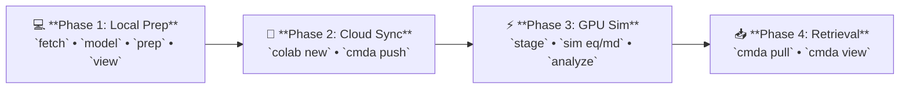

# KRAS (4LDJ) Apo State: Complete Step-by-Step Walkthrough

This tutorial provides the complete simulation workflow for the **Apo state** of the **KRAS GTPase** (UniProt **P01116**, PDB **4LDJ** Chain A, residues **1–169**), comparing the Wild-Type (WT) protein against the oncogenic point mutant **G12D**.



> [!NOTE]
> **Prerequisites & Installation:** Before beginning, ensure the `cmda` conda environment is installed on your local machine. For full multi-platform installation instructions, see the [Installation Guide](../installation.md).

---

## 📁 KRAS Directory Architecture Map

ColabMDA manages project files within a standardized hierarchy under `data/apo/` across all four workflow phases:

```text
research/projects/kras-example/
└── data/
    └── apo/
        ├── structure/
        │   └── P01116_4LDJ/              # Target: UniProt P01116 + Template PDB 4LDJ
        │       ├── raw/                  # Phase 1.2: 4ldj.cif, template.pdb, uniprot.fasta, residues.json
        │       ├── variants/             # Phase 1.3: Modeled backbones (WT/WT.pdb, G12D/G12D.pdb)
        │       └── STRUCTURE_DONE        # Verification QC gate marker
        │
        ├── simulation/
        │   ├── WT/
        │   │   ├── 01_prep/              # Step 1: system.xml, integrator.xml, model.pdb
        │   │   ├── 02_eq/                # Step 2: eq.pdb, system.xml, state.xml, stages/ (24-stage ladder)
        │   │   └── 03_md/                # Step 3: Production replicas (100 ns)
        │   │       ├── r1/               # md.dcd, md.log, state.xml, chunks/0001.dcd
        │   │       ├── r2/               # Independent velocity seed
        │   │       └── r3/               # Triplicate simulation
        │   └── G12D/
        │       ├── 01_prep/
        │       ├── 02_eq/
        │       └── 03_md/{r1, r2, r3}/
        │
        └── analysis/                     # Phase 4: Generated during merge, analyze & compare
            ├── WT/                       # 02_eq/ (qc.png, qc.txt), 03_md/ (r1, r2, r3)
            ├── G12D/
            └── compare/                  # Flat comparison: rmsd.png, rg.png, rmsf.png, summary.txt
```

---

## 💻 Phase 1: Local Modeling & Structure Preparation (Local Machine)
*Execute this phase on your local laptop or workstation CPU. No GPU compute units are required.*

### 1.1. Initialize Local Project Workspace
```bash
# 1. Create and navigate to your project directory
mkdir -p ~/research/projects/kras-example
cd ~/research/projects/kras-example

# 2. Activate local environment
source ~/miniforge3/etc/profile.d/conda.sh
conda activate cmda
```

### 1.2. Structural Fetching & Biological UniProt Mapping
The `cmda fetch` command downloads experimental PDB coordinates, maps canonical UniProt residue numbering, and detects unresolved loop coordinates for subsequent modeling:

```bash
# Fetch KRAS catalytic domain (residues 1–169)
cmda fetch --state apo --pdb-id 4LDJ --uniprot-id P01116 --chain A --range 1 169

# (Optional) Visually inspect the cleaned template in local PyMOL:
pymol data/apo/structure/P01116_4LDJ/raw/template.pdb
```

*What `cmda fetch` generates in `data/apo/structure/P01116_4LDJ/raw/`:*

| File | Purpose | Scientific Role |
| :--- | :--- | :--- |
| **`4ldj.cif`** | Archive Copy | Raw crystallographic record directly from the RCSB PDB archive. |
| **`template.pdb`** | Modeller Input | Stripped monomer coordinates (Chain A) with non-crystallographic waters and buffer additives removed. |
| **`uniprot.fasta`** | Biological Target | Canonical sequence fetched directly from UniProtKB for precise residue numbering. |
| **`residues.json`** | Coordinate Metadata | Residue-by-residue mapping of author PDB numbering to canonical UniProt positions, identifying resolved vs. missing loops. |
| **`input.json`** | Provenance | Machine-readable record containing execution parameters, timestamps, and SHA-256 integrity checksums. |
| **`STRUCTURE_DONE`** | Gate Marker | Verification marker confirming coordinate density and sequence integrity passed all QC gates. |

---

### 1.3. Homology Modeling & Point Mutations (Modeller)
Model the complete Wild-Type coordinates, closing any missing loop residues, then introduce point mutations on the verified WT backbone:

```bash
# 1. Build canonical Wild-Type model (UniProt canonical, residues 1–169)
cmda model --state apo --variant WT

# 2. Visually inspect the modeled WT structure in PyMOL:
pymol data/apo/structure/P01116_4LDJ/variants/WT/WT.pdb

# 3. Build Point Mutant (G12D) on the verified WT backbone
cmda model --state apo --variant G12D

# 4. Compare WT and Mutant (G12D) side-by-side in PyMOL:
pymol data/apo/structure/P01116_4LDJ/variants/WT/WT.pdb data/apo/structure/P01116_4LDJ/variants/G12D/G12D.pdb
```

> [!TIP]
> **PyMOL Verification Checks:**
> * **Residue 12 Inspection:** In the WT vs. G12D comparison, enter `zoom resi 12` and `show sticks, resi 12`. Verify that the Gly12 to Asp12 mutation is present and the Asp12 sidechain is oriented outward into the nucleotide-binding pocket without steric clashes.
> * **Switch I & II Loops:** Confirm that Switch I (residues 30–38) and Switch II (residues 59–67) are modeled continuously as an unbroken cartoon ribbon.

---

### 1.4. Structure Preparation & Solvation (`tleap` + PROPKA at pH 7.4)
Prepare the solvated systems locally using AmberTools. By default, ColabMDA neutralizes system charge with counterions:

```bash
# Solvate with OPC water, neutralize net charge, and assign AMBER titratable protonation states
cmda prep --state apo --variant WT
cmda prep --state apo --variant G12D

# Visually inspect the solvated systems in PyMOL (WT and Mutant):
pymol data/apo/simulation/WT/01_prep/solvated.pdb
pymol data/apo/simulation/G12D/01_prep/solvated.pdb
```

*Key outputs generated in `data/apo/simulation/<variant>/01_prep/`:*
* `model.pdb`: Copy of the input coordinate PDB for reproducibility.
* `solvated.pdb`: Solvated coordinate PDB with protein, water box, and neutralized counterion(s).
* `system.prmtop`: Amber topology containing all `ff19SB` physical parameters.
* `system.inpcrd`: Solvated, charge-neutralized initial coordinates.
* `protonation_summary.json`: Audit log of explicit protonation states assigned by PROPKA at pH 7.4.

#### In-Context Reference: Explicit AMBER Protonation States (PROPKA 3 at pH 7.4)
Accurate protonation states are critical for biophysical fidelity. ColabMDA natively integrates **PDBFixer**, **PDB2PQR**, and **PROPKA 3** during `cmda prep` to evaluate 3D electrostatic microenvironments and assign explicit AMBER titratable residue forms:

| Residue Type | Code | Physical Description & Protonation Criteria |
| :--- | :--- | :--- |
| **Histidine** | `HID` | Neutral Histidine protonated exclusively at $\text{N}_\delta$. |
| | `HIE` | Neutral Histidine protonated exclusively at $\text{N}_\epsilon$ (most common neutral form). |
| | `HIP` | Doubly protonated, positively charged Histidine (both nitrogens protonated, $pK_a > 7.4$). |
| **Acidic** | `ASP` / `GLU` | Negatively charged carboxylate forms (standard physiological state). |
| | `ASH` / `GLH` | Neutral protonated carboxylic acid forms (assigned when local microenvironment $pK_a > 7.4$). |
| **Basic** | `LYS` / `ARG` | Positively charged forms (standard physiological state). |
| | `LYN` | Neutral deprotonated Lysine (assigned when buried in hydrophobic core with $pK_a < 7.4$). |
| **Cysteine** | `CYS` | Free neutral thiol form. |
| | `CYX` | Disulfide-bridged Cysteine form. |

---

### 1.5. Visual Quality Assurance in Local PyMOL
Verify coordinates and the solvated water box before uploading:

```bash
# 1. Inspect modeled coordinates (WT and Mutant):
cmda view --state apo --variant WT
cmda view --state apo --variant G12D

# 2. Compare WT and Mutant side-by-side in PyMOL:
pymol data/apo/structure/P01116_4LDJ/variants/WT/WT.pdb data/apo/structure/P01116_4LDJ/variants/G12D/G12D.pdb

# 3. Inspect the fully solvated systems (water box + neutralizing counterions):
pymol data/apo/simulation/WT/01_prep/solvated.pdb
pymol data/apo/simulation/G12D/01_prep/solvated.pdb
```

---

## 🚀 Phase 2: Launch Colab GPU & Stream Data to Drive
*With models and solvated Amber parameters prepared locally, launch your Colab GPU instance and stream the project directory to Google Drive.*

In your local terminal:

```bash
# 1. Launch a Colab GPU instance
colab new -s kras-sim --gpu T4

# 2. Mount Google Drive (visit the printed authorization link once, then press Enter)
colab drivemount --session kras-sim

# 3. Stream local data/ directly to Google Drive:
cmda push -s kras-sim
```

> [!TIP]
> **Data Destination on Google Drive:**
> * **Google Drive Filesystem Path:** `/content/drive/MyDrive/research/projects/kras-example/data/`
> * **Mechanism:** `cmda push` packages your local `data/` folder, streams it to your active Colab VM (`-s kras-sim`), and extracts it directly into your mounted Google Drive project directory without manual file uploading.

---

## ⚡ Phase 3: Cloud GPU Simulation & Analysis (Google Colab)
*Connect to Google Colab to run OpenMM molecular dynamics simulations on an NVIDIA GPU.*

### 3.1. Connect to Colab GPU Console
In your local terminal:
```bash
colab console -s kras-sim
```

Inside the Colab console terminal, run the environment setup *(see the [Installation Guide](../installation.md#2-cloud-gpu-worker-provisioning-google-colab) for details)*:

```bash
# A. Cloud environment setup (unattended, no license prompts):
curl -fsSL https://raw.githubusercontent.com/paulshamrat/ColabMDA/dev1/scripts/setup.sh | bash

# B. Activate environment & navigate to Drive project directory:
source /root/miniforge3/etc/profile.d/conda.sh
conda activate cmda
cd /content/drive/MyDrive/research/projects/kras-example
```

---

### 3.2. Stage Simulation Hubs & Equilibration
Stage simulation directories and execute the 24-stage progressive heating and restraint release ladder (EM, NVT heating, NPT density relaxation) on GPU:

```bash
# 1. Initialize simulation directories
cmda stage --state apo --variant WT
cmda stage --state apo --variant G12D

# 2. Run equilibration for WT (automatically executes EM -> NVT -> NPT -> QC)
cmda sim eq --state apo --variant WT

# 3. Run equilibration for G12D (automatically executes EM -> NVT -> NPT -> QC)
cmda sim eq --state apo --variant G12D

# (Optional) Re-run standalone QC gating without re-simulating:
# cmda sim qc --state apo --variant WT
# cmda sim qc --state apo --variant G12D
```

---

### 3.2.1. Intermediate Inspection Gate: Pull & PyMOL Visual Verification (Local Machine)
*Before committing cloud compute to 100 ns production runs, verify that the 24-stage equilibration completed stably and that the protein maintained its folded conformation.*

#### Step 1: Pull Equilibration Deliverables to Local Machine
From your **local workstation terminal**:
```bash
cd ~/research/projects/kras-example
cmda pull -s kras-sim
```
*This downloads the lightweight deliverables (`eq.pdb` from simulation, and `qc.png`, `qc.txt` from analysis) to your workstation in seconds.*

#### Step 2: Inspect Convergence Plot & Statistics
Review the gatekeeper outputs for both variants (located in `data/apo/analysis/<variant>/02_eq/`):
* **Wild-Type (WT):**
  * Open `data/apo/analysis/WT/02_eq/qc.png`: Confirms temperature stabilized at $300\text{ K}$ and system density converged to explicit-solvent range ($1.00\text{--}1.02\text{ g/mL}$) with a flat slope.
  * Inspect `data/apo/analysis/WT/02_eq/qc.txt`: Confirms `Status: PASSED`.
* **Mutant (G12D):**
  * Open `data/apo/analysis/G12D/02_eq/qc.png`: Confirms temperature stabilized at $300\text{ K}$ and system density converged ($1.00\text{--}1.02\text{ g/mL}$) with a flat slope.
  * Inspect `data/apo/analysis/G12D/02_eq/qc.txt`: Confirms `Status: PASSED`.

#### Step 3: Structural Inspection in PyMOL (GUI)

<details>
<summary><b>👁️ Click to expand PyMOL GUI inspection guide (Modes A & B)</b></summary>

Launch PyMOL on your local computer (`pymol`) and load the pre- and post-equilibration coordinates:
* **WT**: **`File`** $\to$ **`Open...`** $\to$ select `data/apo/simulation/WT/01_prep/model.pdb` and `data/apo/simulation/WT/02_eq/eq.pdb`
* **G12D**: **`File`** $\to$ **`Open...`** $\to$ select `data/apo/simulation/G12D/01_prep/model.pdb` and `data/apo/simulation/G12D/02_eq/eq.pdb`

---

##### Mode A: Solvent-Stripped Structural Superposition (Backbone Fold Stability)
*Purpose: Verify secondary structure retention and evaluate backbone convergence against the initial modeled coordinates.*

1. **Clean up display (Right Control Panel)**:
   * Next to `(all)`: Click **`H`** (Hide) $\to$ **`waters`**
   * Next to `(all)`: Click **`H`** (Hide) $\to$ **`nonbonded`**
   * Next to `(all)`: Click **`S`** (Show) $\to$ **`as`** $\to$ **`cartoon`**
2. **Distinguish structures by color**:
   * Next to `model`: Click **`C`** (Color) $\to$ **`reds`** $\to$ **`salmon`** (initial modeled reference)
   * Next to `eq`: Click **`C`** (Color) $\to$ **`cyans`** $\to$ **`cyan`** (equilibrated geometry)
3. **Superimpose backbones**:
   * Next to `eq`: Click **`A`** (Action) $\to$ **`align`** $\to$ **`to molecule`** $\to$ select **`model`**
4. **Acceptance Criteria**:
   * Confirm that the equilibrated backbone (`eq`, cyan) closely superimposes on the starting model (`model`, salmon) with typical $\text{C}_\alpha\text{ RMSD} < 1.5\text{ \AA}$. Core secondary structure elements ($\alpha$-helices and $\beta$-sheets) must remain fully intact without local unfolding or unphysical distortions.

---

##### Mode B: Explicit Solvation Cage & Periodic Boundary Inspection (PBC Integrity)
*Purpose: Verify unit cell boundaries, solvent packing, and counterion distribution.*

1. **Display solvent water molecules (Right Control Panel)**:
   * Next to `eq`: Click **`S`** (Show) $\to$ **`lines`**
2. **Display ions as spheres**:
   * Next to `eq`: Click **`S`** (Show) $\to$ **`nonbonded`** (or **`spheres`**)
3. **Color atoms by chemical element**:
   * Next to `(all)`: Click **`C`** (Color) $\to$ **`by element`** $\to$ choose any element palette (heteroatoms and ions are colored automatically)
4. **Display periodic unit cell boundary box**:
   * In top PyMOL menu: **`Setting`** $\to$ **`Edit All...`** $\to$ type `cell` in the filter and set `show_cell` to **`1`**  
     *(Shortcut: type `show cell` into the top command line)*
5. **Acceptance Criteria**:
   * Confirm the protein is centered within the periodic unit cell with a minimum $\ge 10\text{ \AA}$ solvent buffer to each boundary face.
   * Verify that water molecules pack uniformly around the protein surface without vacuum gaps, cavitation bubbles, or atomic clashes.

---

> [!NOTE]
> **Static Coordinate Snapshot vs. Time-Dependent Trajectory Dynamics:**  
> `eq.pdb` is a **static 3D coordinate snapshot** capturing the final minimized and relaxed geometry at the end of the 24-stage equilibration protocol. It contains a single coordinate frame, so it does not exhibit motion or time-series trajectory playback.  
> 
> Real-time **conformational dynamics, thermal fluctuations, and loop flexibility** are recorded during **Phase 3.3 (Production MD)** as the multi-frame binary trajectory (**`md.dcd`**, 10,000 frames) and can be animated via PyMOL trajectory playback controls as described in **Section 4.3** (`cmda view`).

</details>

*Once verified, proceed to launch Production MD (Section 3.3).*

---

### 3.3. Production MD Across Triplicates (`03_md/{r1, r2, r3}`)
Replicas fork from `02_eq/` with distinct random velocity seeds into `03_md/`:

```bash
# Wild-Type Triplicates (100 ns production runs)
cmda sim md --state apo --variant WT --replica r1 --total-ns 100
cmda sim md --state apo --variant WT --replica r2 --total-ns 100
cmda sim md --state apo --variant WT --replica r3 --total-ns 100

# Mutant Triplicates (100 ns production runs)
cmda sim md --state apo --variant G12D --replica r1 --total-ns 100
cmda sim md --state apo --variant G12D --replica r2 --total-ns 100
cmda sim md --state apo --variant G12D --replica r3 --total-ns 100
```

#### In-Context Reference: Simulation Math & Storage Budgeting
Calculate expected trajectory frames:
$$\text{Expected Frames} = \frac{\text{Total Time (ps)}}{\text{Trajectory Saving Interval (ps)}}$$

* **Example:** A $100.0\text{ ns}$ ($100,000\text{ ps}$) simulation with a $10.0\text{ ps}$ saving interval:
  $$\text{Expected Frames} = \frac{100,000\text{ ps}}{10\text{ ps}} = 10,000\text{ frames}$$
* **Saving Every $10\text{ ps}$ (`--traj-interval 10`):** Reduces total raw storage from **~36 GB to ~3.6 GB (a 90% space reduction)** while maintaining 10,000 frames per replica for RMSD, RMSF, PCA, and cross-correlation analysis.
* **Stripped Trajectories (`cmda merge`):** Removing solvent water and bulk ions retains protein coordinates (~2,600 atoms), reducing merged trajectory file sizes to **<200 MB** per replica.

#### 💡 Resuming After a Session Timeout
Production MD writes periodic checkpoints (`prod.chk`) directly to Google Drive. If your session expires:

1. Re-launch the session and re-mount Drive from your local terminal:
   ```bash
   colab new -s kras-sim --gpu T4
   colab drivemount --session kras-sim
   colab console -s kras-sim
   ```
2. In the Colab console, re-activate the environment:
   ```bash
   [ ! -d "/root/miniforge3/envs/cmda" ] && curl -fsSL https://raw.githubusercontent.com/paulshamrat/ColabMDA/dev1/scripts/setup.sh | bash
   source /root/miniforge3/etc/profile.d/conda.sh
   conda activate cmda
   cd /content/drive/MyDrive/research/projects/kras-example
   ```
3. Re-run the exact same `cmda sim md` command:
   ```bash
   cmda sim md --state apo --variant WT --replica r1 --total-ns 100
   ```
   *ColabMDA detects the existing `prod.chk` checkpoint on Google Drive and resumes dynamics from the last saved timestep.*

#### Trajectory Integrity Auditing (`cmda status`)
To verify chunk continuity, frame counts, and resume readiness before or after merging:
```bash
cmda status --state apo --variant WT --replica r1
```

<details>
<summary>🔍 <b>Click to view example status report</b></summary>

```text
[STATUS]
  Workdir          : data/apo/simulation/WT/03_md/r1
  Chunks (DCD/log) : 100 / 100
  Topology File    : solvated.pdb
                     └─ 27273 atoms, 8388 residues
                     └─ (169 protein, 8170 water, 49 ions)
  Trajectory File  : md.dcd (10000 frames)
  Log File         : md.log (10000 frames)
  Frames (from logs): 10000
  Sim time (ps/ns) : 100000.00 ps / 100.0000 ns (from chunk names)
  Resume-ready     : YES (needs prod.chk, system.xml, solvated.pdb)
```

</details>

---

### 3.4. Merge Trajectories & Autoimage PBC
Merge raw 1-ns chunked trajectories into a single continuous file, re-center the protein in the periodic unit cell (`autoimage`), and strip bulk solvent:

```bash
# Merge Wild-Type replicas
cmda merge --state apo --variant WT

# Merge Mutant replicas
cmda merge --state apo --variant G12D
```

*What `cmda merge` outputs in `data/apo/simulation/<variant>/03_md/<replica>/`:*
* `md.dcd`: Clean continuous trajectory merged from `chunks/0001.dcd` ... `chunks/0100.dcd`.
* `md.log`: Continuous merged thermodynamic log table.
* `state.xml`: Final OpenMM physical restart state.

---

### 3.5. Trajectory Analysis & Direct Overlay Comparison
Run biophysical trajectory analysis and generate comparative overlay plots (WT vs. Mutant):

```bash
# 1. Single-variant analysis (RMSD, Radius of Gyration, RMSF)
cmda analyze --state apo --variant WT
cmda analyze --state apo --variant G12D

# 2. Direct comparative overlay (WT vs G12D with Mean ± SD band)
cmda compare --state apo --variants WT,G12D
```

Outputs saved directly in `data/apo/analysis/compare/`:
* `summary.txt` (Executive summary table with Mean ± SD for RMSD, Rg, Temp)
* `rmsd.png` (Comparative time-series with Mean ± SD band)
* `rg.png` (Radius of Gyration compactness comparison)
* `rmsf.png` (Residue fluctuation profiles highlighting Switch I and Switch II loop flexibility)

---

## 📥 Phase 4: Retrieve Results & PyMOL Visualization (Local Machine)
*Switch back to your local workstation terminal.*

### 4.1. Pull Analyzed Data from Cloud
Download analyzed figures, JSON metrics, and stripped trajectories:

```bash
cmda pull -s kras-sim
```

> [!TIP]
> **What `cmda pull` Does:**
> 1. Packages analysis CSVs, logs, summary manifests, and PNG plots from Google Drive.
> 2. Excludes heavy raw trajectory files (`.dcd`, `.chk`) by default so the download completes quickly.
> 3. Extracts files directly into your local `data/` folder.
> *(To download full raw trajectories as well, pass `--all`: `cmda pull -s kras-sim --all`).*

---

### 4.2. In-Context Reference: Topology Pairing Guidelines
When visualizing or analyzing trajectories, the reference topology file used must match the coordinates in the trajectory file:

| Trajectory File | Description | Matching Topology File | Atom Count | Intended Usage |
| :--- | :--- | :--- | :--- | :--- |
| `prod_raw.dcd` | Raw chunked coordinates | `01_prep/solvated.pdb` or `system.prmtop` | ~27,000 atoms | Raw simulation checkpointing & resume. |
| `prod_keep_ligand.dcd` | Merged, PBC autoimaged, solvent-stripped | `03_md/r1/stripped.prmtop` | ~2,600 atoms | Standard biophysical analysis (`cmda analyze`, `cmda compare`). |
| `prod_ca.dcd` | Merged $C_\alpha$ backbone only | `03_md/r1/ca.prmtop` | ~169 atoms | Rapid PCA and essential dynamics. |

> [!WARNING]
> **Topology Pairing Requirement:**
> Loading `prod_keep_ligand.dcd` (~2,600 atoms) with `solvated.pdb` (~27,000 atoms) in PyMOL or MDAnalysis will cause an **atom mismatch error**. Always pair stripped trajectories with `stripped.prmtop`.

---

### 4.3. Visualizing Trajectories in Local PyMOL
```bash
# 1. View Wild-Type production trajectory in local PyMOL:
cmda view --state apo --variant WT --replica r1

# 2. View Mutant (G12D) production trajectory in local PyMOL:
cmda view --state apo --variant G12D --replica r1

# Generate comparative 3x8 transition snapshot grids:
cmda snapshots --state apo
```

Custom snapshot grids can also be produced using a camera configuration JSON:
```json
{
  "align_ref_pdb": "data/apo/structure/P01116_4LDJ/variants/WT/WT.pdb",
  "stable_core_sel": "resi 1-10 or resi 40-55 or resi 80-169",
  "camera_view": [
    0.0, 1.0, 0.0,
    0.0, 0.0, 1.0,
    1.0, 0.0, 0.0,
    0.0, 0.0, -50.0
  ],
  "systems": {
    "WT": {
      "pdb": "data/apo/simulation/WT/03_md/r1/stripped.prmtop",
      "dcd": "data/apo/simulation/WT/03_md/r1/prod_keep_ligand.dcd",
      "states": [1, 200],
      "times": ["0.00 ns", "2.00 ns"],
      "mut_residue": 12
    },
    "G12D": {
      "pdb": "data/apo/simulation/G12D/03_md/r1/stripped.prmtop",
      "dcd": "data/apo/simulation/G12D/03_md/r1/prod_keep_ligand.dcd",
      "states": [1, 200],
      "times": ["0.00 ns", "2.00 ns"],
      "mut_residue": 12
    }
  }
}
```

Execute with:
```bash
cmda snapshots --config camera_config.json
```

<details>
<summary><b>Click to view the generated PyMOL script configuration (<code>visualize.pml</code>)</b></summary>

```text
# 1. Clear out memory
reinitialize
bg_color white

# 2. Load merged trajectory files
load eq.pdb, kras
load_traj md.dcd, kras

# 2b. Align trajectory to crystal reference (e.g., 4ldj_wt.pdb)
load 4ldj_wt.pdb, crystal_ref
align kras and name CA, crystal_ref and name CA, mobile_state=1, target_state=1
delete crystal_ref

# 3. Hide solvent water and ions
hide everything, all
hide nonbonded, all
hide nb_spheres, all

# 4. Fit backbone frame-by-frame
intra_fit kras and name CA

# 5. Generate secondary structure cartoon
dss kras
cartoon automatic, kras
show cartoon, kras

# 6. Apply cyan color scheme
color cyan, kras and name C*
util.cnc("kras")

# 7. Highlight mutated residue 12 side chain sticks
show sticks, kras and resi 12 and not name N+C+O+H
color yellow, kras and resi 12 and name SG
set stick_radius, 0.25

# 8. Focus camera onto protein
zoom kras and polymer, buffer=4
```

</details>

---

<details>
<summary><b>🛠️ Alternative: In-Browser Colab Terminal Execution (Single VM)</b></summary>

For users running the entire workflow interactively inside a single Google Colab browser terminal:

```bash
# 1. Install scientific environment & ColabMDA in the Colab Terminal
cd /content
WITH_MODELLER=1 bash -c "$(curl -fsSL https://raw.githubusercontent.com/paulshamrat/ColabMDA/dev1/scripts/setup.sh)"
source ~/miniforge3/etc/profile.d/conda.sh
conda activate cmda

# 2. Build Wild-Type KRAS (Starting at Residue 1 matching UniProt)
colabmda modeller build --pdb-id 4ldj --uniprot-id P01116 --chain A --range 1 169 --uniprot-numbering --outdir data/structure/4ldj/wt

# 3. Create Point Mutant (G12D) preserving biological numbering
colabmda modeller mutate --pdb-in data/structure/4ldj/wt/target.B99990001_with_cryst.pdb --chain A --mut G12D --outdir-mut data/structure/4ldj/mutants/4ldj_g12d

# 4. Structure preparation & 3D pKa titration at pH 7.4
colabmda openmm prep --pdb-file data/structure/4ldj/wt/4ldj_wt.pdb --outdir data/structure/4ldj/wt/prep --name 4ldj_wt --ph 7.4
colabmda openmm prep --pdb-file data/structure/4ldj/mutants/4ldj_g12d/4ldj_g12d.pdb --outdir data/structure/4ldj/mutants/4ldj_g12d/prep --name 4ldj_g12d --ph 7.4

# 5. Modular simulation stages
colabmda openmm stage --pdb-file data/structure/4ldj/wt/prep/4ldj_wt_cleaned.pdb --name 4ldj_wt --replica r1
colabmda openmm em --name 4ldj_wt --protein-ff ff19SB --water-model opc
colabmda openmm nvt --name 4ldj_wt --equil-time 100
colabmda openmm npt --name 4ldj_wt --equil-time 100
colabmda openmm qc --name 4ldj_wt
colabmda openmm md --name 4ldj_wt --replica r1 --total-ns 100.0 --traj-interval 10
colabmda openmm merge --name 4ldj_wt --replica r1 --center --wrap
colabmda openmm analysis --name 4ldj_wt --replica r1
```

</details>

---

## Acknowledgements
- [OpenMM](https://openmm.org) & [PDBFixer](https://github.com/openmm/pdbfixer)
- [Modeller](https://salilab.org/modeller/)
- [MDAnalysis](https://www.mdanalysis.org) & [MDTraj](https://www.mdtraj.org)
- [PDB2PQR & PROPKA](https://server.poissonboltzmann.org/)
- [NumPy](https://numpy.org), [Matplotlib](https://matplotlib.org), [Biopython](https://biopython.org)
- [Google Colab](https://colab.research.google.com) & [Miniforge/Conda](https://github.com/conda-forge/miniforge)

---

## Citation

Initially, this repository was based on a GROMACS-on-Colab workflow, but was transitioned to OpenMM to improve performance and stability for automated simulation recovery on cloud platforms.

If you use this tool, please cite the underlying studies:

> Paul SK, Saddam M, Rahaman KA, Choi JG, Lee SS, Hasan M. **Molecular modeling, molecular dynamics simulation, and essential dynamics analysis of grancalcin: An upregulated biomarker in experimental autoimmune encephalomyelitis mice.** *Heliyon*. 2022 Oct 23;8(10):e11232. doi: [10.1016/j.heliyon.2022.e11232](https://doi.org/10.1016/j.heliyon.2022.e11232). PMID: 36340004; PMCID: PMC9626934.
>
> [](https://doi.org/10.1016/j.heliyon.2022.e11232)
>
> Paul SK, Saddam M, Tabassum N, Hasan M. **Molecular dynamics simulation of wild and mutant proteasome subunit beta type 8 (PSMB8) protein: Implications for restoration of inflammation in experimental autoimmune encephalomyelitis pathogenesis.** *Heliyon*. 2024 Dec 15;11(1):e41166. doi: [10.1016/j.heliyon.2024.e41166](https://doi.org/10.1016/j.heliyon.2024.e41166). PMID: 39802026; PMCID: PMC11719297.
>
> [](https://doi.org/10.1016/j.heliyon.2024.e41166)

---

<p align="center">
  
</p>
